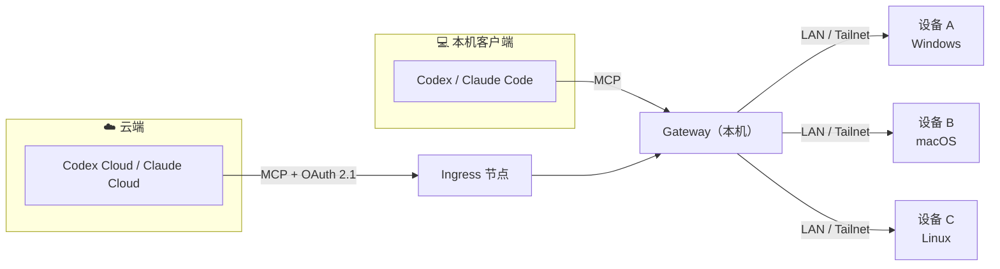

<div align="center">

# xmesh

**让云端 Agent 用上你真实的开发机器。**

把 Windows / macOS / Linux 设备上的终端、文件和本机 MCP 工具，<br>
通过标准 Remote MCP 交给 Codex、Claude Code 以及 Codex Cloud、Claude Cloud 等云端 Agent 调用。

[](https://github.com/tzf1003/xmesh/releases)
[](https://github.com/tzf1003/xmesh/actions/workflows/go.yml)
[](https://tzf1003.github.io/xmesh/)


[**安装首页**](https://tzf1003.github.io/xmesh/) · [快速开始](#-快速开始) · [文档](docs/README.md) · [发布列表](https://github.com/tzf1003/xmesh/releases) · [llms.txt](llms.txt)

</div>

---

## 📖 xmesh 是什么

XmeSh（X mesh，也读作 X me sh：「我的 sh」）是一个把**开发设备**组成网格、再以 **MCP（Model Context Protocol）** 形式开放给 AI Agent 的工具。

云端 Agent 只有沙箱：碰不到你机器上的 IDA、Xcode、MSVC、GPU 和本地环境，而你的设备通常又在 NAT 之后、没有公网 IP。xmesh 解决的就是这件事：

- 每台机器运行**同一个** `xmesh` 进程，同时承担 **Agent**（提供本机能力）与 **Gateway**（聚合所有设备）角色。
- 设备之间通过统一公钥（或连接密码）配对，可在**局域网**和 **Tailnet** 上独立互联，首选 LAN、断线自动恢复。
- 需要给云端用时，任一节点加上 `--ingress` 即可提供带 **OAuth 2.1** 的公网 Streamable HTTP MCP 端点。
- 对外只说标准 MCP，不发明新协议；所有冲突都以结构化错误返回，由模型自行决策。



## ✨ 功能

| | 能力 | 说明 |
| --- | --- | --- |
| 🖥️ | **终端与命令** | `exec.*` 一次性执行命令，`pty.*` 提供可交互的伪终端会话 |
| 📁 | **文件读写与互传** | `fs.*` 浏览、读写文件；`fs.upload` / `fs.download` 分块传输并校验 SHA-256，默认单文件上限 1 GiB |
| 🔌 | **本机 MCP 聚合** | 把设备上已有的 MCP 服务（如 IDA MCP）挂载进来，统一以 `<设备名>/<工具>` 暴露 |
| 🌐 | **多设备网格** | LAN 与 Tailnet 共存，设备只在私网内可达，Gateway 聚合全部设备并提供 `devices.list` |
| ☁️ | **云端入口** | `--ingress` 提供公网 MCP 端点，内置 OAuth 2.1，令牌有效期与 scope 上限可配 |
| 🔒 | **权限边界** | 按目录 allow / deny，分「开发」与「只读」两档权限，并发操作有租约与排他规则 |
| 🧭 | **图形化管理** | Windows / macOS 桌面托盘应用与设置向导；Linux 提供同款网页管理面板 |
| ⚙️ | **GitHub Actions 运行器** | 在面板里绑定仓库，由内核托管、保活官方 Actions 运行器 |

## 🚀 快速开始

> [!TIP]
> 最省事的方式：打开 **[安装首页](https://tzf1003.github.io/xmesh/)**，页面会识别你的系统并给出对应的下载链接，还附带一段可直接交给 Agent 的「安装提示词」。

### Windows / macOS

1. 前往[安装首页](https://tzf1003.github.io/xmesh/)或[发布列表](https://github.com/tzf1003/xmesh/releases)，按系统和芯片（`amd64` = Intel/AMD x64，`arm64` = Apple silicon / Windows on ARM）下载当前用户安装包。
2. 安装后打开 xmesh，**设置向导**会依次询问：
   - 用途：本机使用 / 多设备互联 / 云端 Agent
   - 工作目录：允许 Agent 访问哪些目录
   - 权限：开发（可读写、可执行命令）或只读
   - 客户端：Codex、Claude Code（自动写入它们的 MCP 配置）
3. 确认计划后执行，然后在客户端里发起一次真实请求，完成连接验证。

<details>
<summary>用脚本安装（可校验、可离线、适合自动化）</summary>

每个版本都提供 `manifest.json`（平台、架构、SHA-256、大小、签名状态）、`install.sh`、`install.ps1` 与离线 ZIP。下载并**检查脚本内容**后运行：

```bash
# macOS
bash install.sh --channel stable --json
bash install.sh --version v1.2.3 --json          # 固定版本
```

```powershell
# Windows
.\install.ps1 -Channel stable -Json
.\install.ps1 -Version v1.2.3 -Json               # 固定版本
```

- 稳定版要求 Windows Authenticode / macOS 签名 + 公证 + 装订验证。
- beta / rc 属于 `testing` 通道；明确未签名的测试包需加 `--allow-unsigned` / `-AllowUnsigned`，系统信任检查仍然生效。
- 支持 `--download-only`、`--offline DIR`、重试缓存和 JSON 输出，结束时返回可长期使用的 CLI 路径。

完整参数、升级与恢复见[安装说明](docs/agent/install.md)。示例中的 `v1.2.3` 请替换为实际已发布的版本。

</details>

### Linux

Linux 没有桌面安装包，`install-linux.sh` 会把**内核**和**网页管理面板**各装成一个 systemd 用户服务，并在终端里引导你设置工作目录、权限和面板的管理密钥。

```bash
# 1. 从发布页下载安装脚本（把版本号换成发布列表中的实际版本）
VERSION=v1.2.3
curl -fsSLO "https://github.com/tzf1003/xmesh/releases/download/$VERSION/install-linux.sh"

# 2. 检查脚本后，以普通用户身份运行（不要用 sudo）
bash install-linux.sh --version "$VERSION"

# 3. 浏览器打开网页管理面板
xdg-open http://127.0.0.1:7480/
```

| 常用选项 | 作用 |
| --- | --- |
| `--channel stable\|testing` | 自动选择该通道的最新版本 |
| `--no-webui` | 只装内核，无需 Node.js |
| `--offline DIR` | 从本地目录安装，不访问网络 |
| `--update` | 就地更新程序，保留节点配置与管理密钥 |
| `--yes --workspace DIR --permission readonly` | 非交互安装 |

依赖：`curl`、`tar`、`sha256sum`、`python3`、systemd 用户会话；网页面板需要 Node.js ≥ 22.18。详见[安装说明 · Linux](docs/agent/install.md#linux) 与 [Linux 网页管理界面](ui/README.md#linux-网页管理界面)。

### 让 Agent 帮你装

xmesh 的文档对 Agent 友好。把下面这句话交给本机的 Codex 或 Claude Code：

```text
请阅读 https://tzf1003.github.io/xmesh/llms.txt，按其中的安装与 setup 文档帮我安装并配置 xmesh：
先检查环境并展示 setup plan，等我确认后再 apply，最后用真实请求验证连接。
```

Agent 会使用 `xmesh setup inspect → plan → apply → status → verify` 完成配置，遇到问题时用 `xmesh setup resume` 和 `xmesh doctor` 恢复。

## 🛠️ 从源码运行

需要 **Go 1.27**。先在 [`xmesh.local.yaml`](xmesh.local.yaml) 中设置允许访问的目录，然后：

```bash
go run ./cmd/xmesh serve --local --config xmesh.local.yaml   # 启动本机 Agent + Gateway
go run ./cmd/xmesh status                                    # 查看运行状态
go run ./cmd/xmesh status --endpoint http://127.0.0.1:8080/mcp --tool local/sys.info
go test -race ./...                                          # 运行测试
```

`xmesh.local.yaml` 同时启用两个角色：

| 角色 | 地址 | 提供的工具 |
| --- | --- | --- |
| Agent | `http://127.0.0.1:7433/mcp` | `sys.info`、`fs.*`、`pty.*`、`exec.*` |
| Gateway | `http://127.0.0.1:8080/mcp` | 同一批工具加 `local/` 前缀（如 `local/exec.run`），并聚合已入网设备（`<设备名>/exec.run`）以及 `devices.list` 等 |

客户端使用带会话的 Streamable HTTP MCP 连接。`--local` 是显式的开发模式。桌面应用（Electron）的开发方式见 [`ui/README.md`](ui/README.md)。

## 💻 命令行

同一个 `xmesh` 二进制提供以下子命令，完整参数运行 `xmesh help` 查看：

| 命令 | 作用 |
| --- | --- |
| `xmesh serve --config xmesh.yaml` | 按配置启动已启用的角色（`agent`、`gateway`、`ingress`）。`--local` 为本机开发模式，`--ingress` 临时加上入口角色 |
| `xmesh setup …` / `xmesh doctor` | 引导式配置：`inspect`、`plan`、`apply`、`status`、`resume`、`verify`；`doctor` 诊断并给出修复建议 |
| `xmesh install --config xmesh.yaml` | 安装为用户级常驻服务：macOS LaunchAgent、Linux systemd 用户服务、Windows 登录计划任务（`--system` 改为管理员 SCM 服务） |
| `xmesh pair --export 文件` / `--import 文件 --fingerprint 指纹` | 导出本机公钥、导入并核对对端指纹，建立设备信任 |
| `xmesh status` | 读取运行中节点的 `sys.info`；`--json` 输出原始 JSON |
| `xmesh migrate --config xmesh.yaml` | 备份并把旧配置转换为 `schema_version: 2` |
| `xmesh version` | 打印版本号 |

<details>
<summary>补充说明</summary>

- **Windows**：发行包同时提供命令行 `xmesh.exe` 和无控制台的 `xmesh-background.exe`。登录任务使用后者，不会弹出黑框；两份内核须放在同一目录。
- **配置版本**：新版配置使用 `schema_version: 2`，通过 `mesh.lan.enabled` 与 `mesh.tailnet.enabled` 开启 LAN / Tailnet 共存。旧节点停止后运行 `xmesh migrate`，再按新版重新配对。
- **文件互传**：调用 `<设备名>/fs.upload` / `fs.download`；上传完成前保留原文件，同名冲突默认拒绝，`force: true` 才原子覆盖。单文件上限可在「设置 → 文件互传」或 `agent.fs.max_file_size`（如 `2GiB`、`unlimited`）中修改。参数见[文件互传契约](docs/contracts/fs.md#ctr-fs-08)，示例客户端见 [`scripts/file_transfer.py`](scripts/file_transfer.py)。

</details>

## 📚 文档

方案、约束和契约都在 [`docs/`](docs/README.md)：

| 想知道什么 | 从这里读 |
| --- | --- |
| 要解决什么问题、系统长什么样 | [概述](docs/design/01-overview.md) · [架构](docs/design/02-architecture.md) |
| 怎么安装、配置和连接客户端 | [Agent 指南](docs/agent/README.md) · [安装](docs/agent/install.md) · [客户端](docs/agent/clients.md) · [排障](docs/agent/troubleshooting.md) |
| 如何构建、配对、入网和运行 | [运行手册](docs/operations.md) · [实现记录](docs/implementation-status.md) |
| 实现时哪些规则不能破 | [约束](docs/constraints/README.md) |
| 工具、错误、租约、OAuth 的精确行为 | [契约](docs/contracts/README.md) |
| 某条规则落到哪一阶段的测试 | [符合性矩阵](docs/conformance.md) |

## 📂 仓库结构

```text
cmd/xmesh/        命令行入口（单一二进制）
internal/         内核：Agent、Gateway、Ingress、mesh、工具实现
meshadmin/        Tailscale / Headscale 控制面与 DERP 管理（xmesh mesh）
computer-native/  原生桌面执行器（Rust）
ui/               桌面托盘应用与 Linux 网页管理面板（Electron + React）
packages/ui-mcp/  在节点上运行 Web / Electron UI 测试的 MCP 服务
scripts/          安装脚本、发布与安装站点构建
docs/             设计、约束、契约与运行文档
```

## 🤝 参与贡献

欢迎提交 Issue 和 Pull Request。动手前请先读[约束](docs/constraints/README.md)与相关[契约](docs/contracts/README.md)；提交前运行 `go test -race ./...`，涉及界面时运行 `ui/` 下的 `npm test`。测试版（pre-release）的发布方式见[运行手册](docs/operations.md)中的「测试版发布」。
