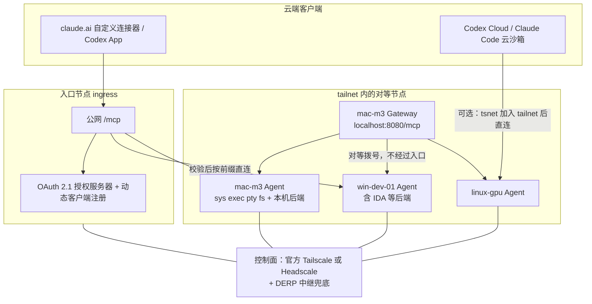
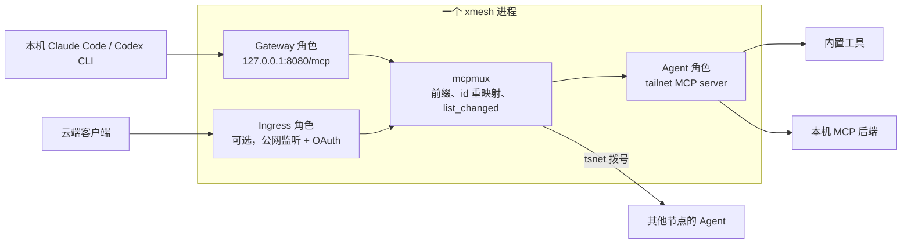

# 2. 整体架构

每台机器跑同一个 `xmesh` 进程，既是 Agent（在 mesh 上暴露本机工具），也是 Gateway（在 `localhost:8080/mcp` 给本机的 Claude Code / Codex CLI 聚合全网工具）。云端没有 tailnet，只能访问 URL，所以由一个开了入口角色的节点提供公网 MCP 端点。这个节点可以是打开 Funnel 的本机，也可以是一台 VPS。

## 调用路径

云端 Agent → 入口节点 `/mcp`（OAuth 校验、剥节点前缀、审计）→ tailnet 直连目标节点 → 内置工具或本机 MCP 后端 → 原路返回。

节点之间直接互调：Mac 上的 Claude Code 连本机 xmesh 就能调 `win-dev-01/ida.decompile_function`，Windows 上的 Codex 连它自己的 xmesh 就能调 `mac-m3/exec.run`，不经过入口节点。

下面的图是 Mermaid。GitHub 会渲染成流程图；纯文本阅读器看到的是源码。

## 组件

| 组件 | 职责 | 运行位置 | 状态 |
| --- | --- | --- | --- |
| xmesh 节点（Agent 角色） | tsnet 监听；内置 `sys` / `exec` / `pty` / `fs`；挂载本机 MCP 后端；资源配额与租约 | 每台开发设备 | 有状态，自身资源的唯一权威 |
| xmesh 节点（Gateway 角色） | `localhost:8080/mcp` 聚合 `local/*` 与对等节点 `<peer>/*`；设备发现；路由 | 每台开发设备 | 无状态 |
| xmesh 入口节点（`--ingress`） | 公网 `/mcp`；OAuth 2.1 授权服务器 + 动态客户端注册；审计、配额 | Funnel（本机直接对外）或 VPS | 无状态 |
| 控制面（官方 Tailscale 或 Headscale）+ DERP | tailnet 协调（密钥、ACL、DNS）与中继兜底 | 官方托管，或自有 VPS | 控制面 |

Gateway 与入口转发时只做三件事：剥前缀、鉴权、审计。它们不保存 PTY、租约、幂等缓存或文件锁；这些状态只存在于目标 Agent 进程内存中。见 [INV-03](../constraints/invariants.md#inv-03)。

## 角色如何叠在一个进程里

`mcpmux` 被 Gateway、Ingress 和 Agent 的后端转发共用。它是最先实现并配齐测试的核心，见 [CON-IMPL-02](../constraints/implementation.md#con-impl-02)。
