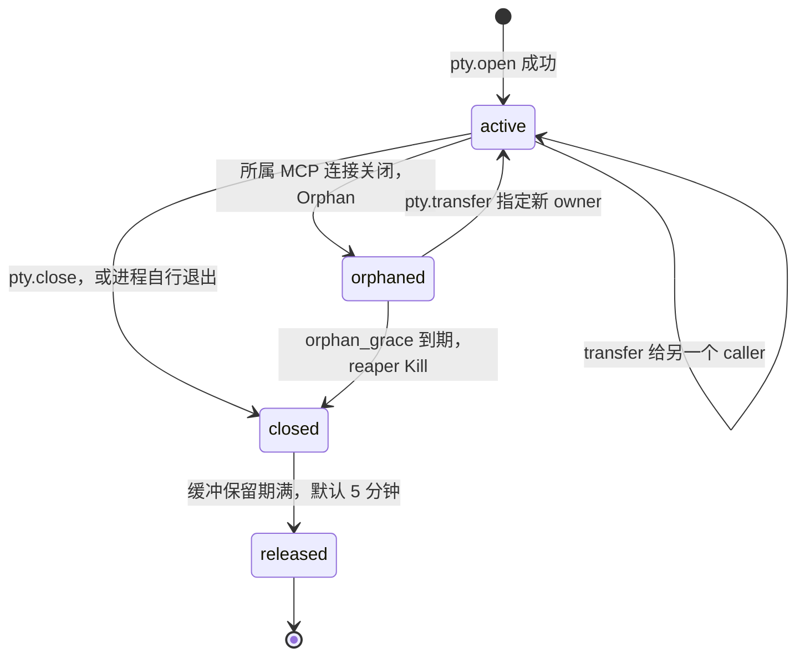

# 6. 并发与资源治理

设备上只有四类资源会被多个调用方争用。各类用独立策略，不设全局大锁。见 [CON-CONC-01](../constraints/concurrency.md#con-conc-01)。

调用方身份：

```text
caller_id = tailnet 节点 ID + MCP session id
```

它是所有配额、租约和所有权的 owner。格式见 [CTR-ID-01](../contracts/identity.md)。

| 资源 | 冲突 | 策略 |
| --- | --- | --- |
| PTY 会话 | 两个调用方写同一终端 | 会话池 + owner。非 owner 只读。`transfer` 显式交接 |
| exec | 并发过高、网关重试重复执行 | 每设备并发槽 + `idempotency_key` 结果缓存 |
| 后端 MCP（IDA 等单实例有状态） | 调用交替导致上下文串掉；stdio 只有一条连接 | 每后端一个 actor goroutine 串行。`exclusive` 要求租约 + fencing token |
| 文件 | 半写入被读到、覆盖他人修改 | 原子写。`expected_sha256` 乐观并发。`fs.edit` 自带唯一匹配保护 |

## PTY 会话池

- 设备硬上限 `max_sessions: 20`，单调用方 `max_per_caller: 8`。`Open` 内原子检查并递增，防止并发 open 穿透到 21。见 [INV-02](../constraints/invariants.md#inv-02)。
- 每会话一个环形缓冲（1 MiB）+ 单调递增 cursor。写入 goroutine 追加后 `Broadcast`。多个读者各持自己的 cursor。cursor 落入被覆盖区域时返回 `truncated: true`。
- `pty.read` 为 long-poll：无新输出时最多等 `wait_ms`，避免模型空转轮询。
- 后台 reaper 每 30 秒扫描 idle / orphan / closed 超时。上层 MCP 连接关闭时调 `Orphan(caller)`，把该调用方全部会话转为 orphaned。
- 关闭顺序：Kill → 等 PTY 读 goroutine EOF → 标 closed → 唤醒所有 reader（`eof: true`）→ 延迟回收缓冲。

### PTY 状态机

四个状态：`active`、`orphaned`、`closed`、`released`。名称是 [RUL-07](../contracts/rulings.md#rul-07) 对原文「4 个状态」的裁定，转移条件来自本节正文。



| 状态 | owner | 可写 | 可读 | 说明 |
| --- | --- | --- | --- | --- |
| `active` | 有 | 仅 owner | 任何调用方 | 正常会话 |
| `orphaned` | 无 | 否 | 任何调用方，直到进程被 Kill | 宽限期内保留，供 `transfer` 接回 |
| `closed` | 原 owner 仍记录在列表里 | 否 | 任何调用方，`eof: true` 之后只有缓冲 | 缓冲保留，`pty.list` 仍可见 |
| `released` | — | — | — | id 失效，再读返回 `session_not_found` |

idle 超时作用在 `active`：`idle_timeout` 内没有读写则由 reaper 关闭。`orphaned` 使用单独的 `orphan_grace`，不套用 idle。

## exec 并发槽

- 默认 `shared` 槽 4、`exclusive` 槽 1。`exclusive` 等所有 shared 排空后执行。
- 队列 FIFO，并按 caller 公平。不能在本次 `timeout` 内获得槽位时，返回 `exec_saturated`，其中包含 `queue_position`。见 [RUL-01](../contracts/rulings.md#rul-01) 与 [CTR-EXEC-01](../contracts/exec.md)。
- `idempotency_key` 命中缓存直接返回历史结果，保留最近 200 条。缓存按 `caller_id` 隔离，见 [RUL-04](../contracts/rulings.md#rul-04)。

## 后端策略与租约

| policy | 适用 | 行为 |
| --- | --- | --- |
| `shared` | 无状态后端 | actor 串行，无需租约 |
| `exclusive` | IDA 等单实例有状态 | 先 `backend.acquire(name, ttl)` 拿租约，返回单调递增的 fencing token。调用必须带 token。不匹配返回 `resource_busy` |
| `per-caller` | 支持多实例的后端 | 按上游 session 起独立进程。session 关闭或 idle 超时回收 |

租约靠持有者心跳续期（Gateway 代表会话续期，或调用方直接 `backend.renew`）。掉线后在 TTL 内自动释放。后端崩溃重拉后 token 递增，旧租约作废。见 [INV-01](../constraints/invariants.md#inv-01)。

实现为单机内存 `sync.Mutex` + map。Agent 重启后租约全清。不做跨进程或跨节点的租约复制。

## MCP 协议层多路复用

上游多个调用方对到后端的单条 MCP 连接时：

- Agent 重写 JSON-RPC `id`，维护 `(上游连接, 上游 id) ↔ 后端 id` 映射。
- `progressToken` 同样映射，进度通知路由回正确的上游。
- 后端发起的 sampling / elicitation 请求路由给当前租约持有者。无持有者则拒绝。
- 后端崩溃：自动拉起，向所有上游发 `notifications/tools/list_changed`。

映射表、拒绝条件和崩溃顺序见 [mcpmux 契约](../contracts/mcpmux.md)。
