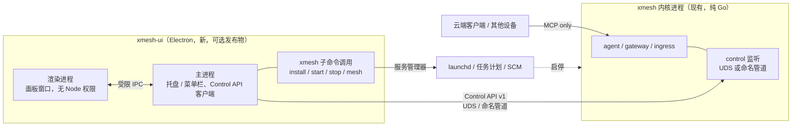

# 12. 桌面 UI 与本机控制通道

本篇记录一条未来开发路径：给 Windows 和 macOS 做系统托盘 / 菜单栏图标和管理面板，并且让 UI 与内核解耦。它是路线图阶段 6，不是新的验收门，也不改变阶段 1 到 5 的任何契约。本篇只写方案和拆分，不含实现。

日期：2026-10-16。基线：master `a91cac6`。

「工具栏」按 Windows 通知区域托盘图标和 macOS 菜单栏图标理解。窗口内的顶部工具栏属于面板，见 [面板](#面板)。

## 为什么要解耦

- 内核（`xmesh serve`）本来就是常驻无界面进程：Windows 用户任务或 SCM 服务，macOS LaunchAgent，Linux systemd 用户服务。`install --system` 的服务运行在 Session 0，根本不能弹窗。UI 只能是另一个进程。
- 发布流水线 `release.yml` 在 Ubuntu 上以 `CGO_ENABLED=0` 交叉编译六个目标。UI 采用 Electron（Node 运行时加 Chromium，打包后上百 MB），只能是独立发布物，并入内核二进制会破坏纯 Go 的小体积交叉编译。
- [CON-ARCH-02](../constraints/architecture.md#con-arch-02) 要求内核发布物是单个 `xmesh` 二进制，三个角色同进程。UI 是可选的第二个发布物，内核没有它必须完整可用，所以不与该约束冲突，但需要写成裁定。
- UI 崩溃、升级、被用户退出，都不能影响节点上的 PTY、租约和进行中的 exec。

## 现状：UI 现在能依赖什么

| 能力 | 现状（master） | 对 UI 的影响 |
| --- | --- | --- |
| 读状态 | `xmesh status` 通过 MCP 调 `sys.info`，`--local` 时是 `127.0.0.1:7433` 无认证；Gateway 需 PAT | 这是面向模型的工具面，不能当 UI 控制通道。字段够做概览，但没有变更推送 |
| 设备列表 | Gateway 的 `devices.list` | 够用，但要经 Gateway 与 PAT |
| 排空 | 仅 tailnet Agent 上的 `/control/drain`，要 `tag:admin`；排空状态只在内存，没有「恢复」，重启才重置 | 本机 UI 没有入口；需要新增 resume |
| 配置 | `config.Store` 只读文件，文件变更后下一次 `Get()` 热加载，失败保留旧配置 | 没有写入路径；UI 写配置需要校验、原子写入和并发冲突检测 |
| 事件 | 没有事件总线。审计只写 `audit/*.jsonl`，只含元数据 | UI 要实时状态，需要新增事件流 |
| 配对、PAT、OAuth 口令 | `xmesh pair`、`gateway.pats` 的文件、`--oauth-password-file`，全是 CLI 或手工文件 | UI 要把这三件事做成向导，内核侧需要对应接口 |
| 服务安装 | `xmesh install`；没有 `uninstall`、`start`、`stop`、`restart` | UI 要管理生命周期，需要补子命令 |

## 总体结构

两个接口，各自稳定：

1. **Control API v1**：内核对本机用户暴露的 JSON over HTTP，走 Unix 域套接字（macOS、Linux）或命名管道（Windows），不走 TCP。UI 的所有读写都经它。
2. **`xmesh` CLI**：服务安装、启停、卸载、配对这类内核进程不能自己做的事，UI 调用同一个二进制的子命令，并要求这些子命令提供 `--json` 输出。CLI 与 UI 共用同一份行为，不在 UI 里复制安装逻辑。

云端和其他设备仍然只看见 MCP。Control API 不挂在 Gateway、Ingress、tailnet 监听器上，也不是 MCP 工具。

## 控制通道

### 传输与身份

| 平台 | 端点 | 访问控制 |
| --- | --- | --- |
| macOS、Linux | 状态目录下 `control.sock`，目录 `0700`，套接字 `0600`。路径超过 UDS 长度上限时落到 `/tmp/xmesh-<uid>/`（固定位置，不随 `$TMPDIR`） | 连接时用对端凭据（`LOCAL_PEERCRED` / `SO_PEERCRED`）核对 uid 等于内核运行用户 |
| Windows | 命名管道 `\\.\pipe\xmesh-<sid>-<节点名>` | 创建时设置 DACL：运行用户 SID、`SYSTEM`、`Administrators`；`install --system` 时额外授权安装者的 SID；拒绝远程客户端（`PIPE_REJECT_REMOTE_CLIENTS`） |

状态目录里写 `control.json`（端点、内核版本、Control API 版本、PID），UI 通过枚举 `<UserConfigDir>/xmesh/*/control.json` 发现本机所有节点实例（Windows 另外列出 `%ProgramData%\xmesh`，按节点名精确打开 `<节点名>\control.json`，用于 `install --system` 的系统服务内核；节点目录本身普通用户不能列出）。一个用户可以有多个节点，面板按实例切换。

### 为什么不用 loopback TCP

任何本机进程和任何网页都能向 `127.0.0.1` 发请求，DNS rebinding 与 CSRF 都要靠额外防护。OS 级的套接字和管道权限更直接。同样的理由，现有 `127.0.0.1:7433` 的 MCP 监听也不能兼作控制通道，它面向模型，无认证。

### 同用户信任边界

内核运行用户下的任何进程都能连控制通道，这包括该用户的 L1 `exec.run` 子进程。但 L1 下这类进程本来就能直接改 `xmesh.yaml`（热加载生效）、读 PAT 文件，控制通道没有增加权限。要点：

- L2 沙箱必须挡住控制端点：Seatbelt 规则拒绝连接该套接字，bwrap 不绑定状态目录，Windows AppContainer 不在管道 DACL 中。这写成沙箱验收项。
- 配置写入只返回「改了什么」和「是否需要重启」，所有通过控制通道发生的变更，审计记 `actor=control`，仍只含元数据。
- 削弱安全的变更（`allow_dangerous`、放宽 `cwd_policy`、放宽 `authz`）由 UI 弹确认对话框。这是 UI 侧的体验保护，不是内核的授权边界，写入文档时必须讲清，不得让用户误以为内核会拦截。
- UI 不得变成工具调用的审批通道。[CON-ARCH-05](../constraints/architecture.md#con-arch-05) 仍然成立：冲突、策略拒绝、配额拒绝在同一次调用里返回结构化错误，UI 只展示，不放行。

### API 范围（v1）

契约已落在 [CTR-CTL-01 至 12](../contracts/control.md)，下表是设计时的草案；与契约不一致处以契约为准（例如事件流多了 `hello` 与 `reset`，`status.warnings` 是结构化数组，另有能力协商）。

路径前缀 `/v1`，请求与响应是 JSON，错误沿用 [CTR-ERR-01](../contracts/errors.md#ctr-err-01) 的信封。变更使用 `ETag` / `If-Match` 防并发覆盖。

| 端点 | 作用 | 内核侧状态 |
| --- | --- | --- |
| `GET /v1/status` | 节点、角色、网络身份、健康、`restart_required`、`warnings`、配额占用。字段是 `sys.info` 的超集 | 大部分已有，需汇总 |
| `GET /v1/events` | SSE 事件流，支持 `Last-Event-ID` 续传，环形缓存 1024 条 | 新增 |
| `GET /v1/peers` | 设备、在线状态、tag、直连或 DERP | 新增（数据来自 mesh） |
| `GET /v1/sessions` | PTY、进行中 exec、后端租约，只读 | 新增只读视图 |
| `POST /v1/drain`、`POST /v1/resume` | 排空（keep / kill）与恢复 | drain 已有；resume 新增 |
| `GET/PUT /v1/config` | 读取当前生效配置；写入前经 `config.Parse` 校验，临时文件加重命名原子写，返回 diff 与 `restart_required` | 新增。保留 YAML 注释，使用 yaml.Node 往返 |
| `GET/PUT/DELETE /v1/pair/password`、`GET /v1/pair/discovered`、`POST /v1/pair/connect` | LAN 连接密码配对与内网发现（1.2）；口令只写不读，见 [14](../design/14-password-pairing.md) | 新增，底层是 `internal/mesh` 的 SPAKE2 配对 |
| `POST /v1/pair/export`、`POST /v1/pair/import` | LAN 配对文档（高级用法）；导入必须带 UI 用户确认过的指纹 | 逻辑已有（`xmesh pair`），抽成库 |
| `GET/POST/DELETE /v1/pats` | 列出、创建、轮转、撤销本机 Gateway PAT。令牌正文只在创建响应里出现一次，并直接写入 `0600` 文件，之后不可读回 | 新增 |
| `GET/DELETE /v1/ingress/clients` | 查看已注册 OAuth 客户端，撤销；口令轮转只写不读 | 新增 |
| `GET /v1/audit` | 按时间与过滤条件读审计元数据 | 新增只读视图，沿用 [CTR-AUD-01](../contracts/audit.md) 字段，禁止正文 |

事件类型：`status`、`peer`、`call`（工具名、设备、状态、耗时，不含参数与输出）、`session`、`warning`、`config`、`lifecycle`。

### 版本与兼容

- API 只加不改。破坏性变化升到 `/v2`，内核同时提供 `/v1` 至少一个发布周期。
- `control.json` 与每个响应带 `X-Xmesh-Control-Version`。UI 遇到内核版本不兼容时进入「内核版本不匹配」状态，只保留打开日志目录和升级入口。
- 内核与 UI 版本独立，但前期同一个 tag 一起发布。

### 契约与解耦的工程保证

- 契约落在 `docs/contracts/control.md` 和 `schemas/control-*.schema.json`，正反例夹具接入现有 `check_examples.py`。
- 内核新增 `internal/control`，Go 类型放在公开包 `api/control/v1`，供内核与 CLI 使用。
- UI 是 Electron 加 TypeScript 项目（`ui/package.json`），不 import 任何 Go 包，与内核之间只有 JSON Schema 这一份契约。UI 的类型由 `schemas/control-*.schema.json` 生成，CI 重新生成后 `git diff --exit-code`，生成物与契约不一致即失败。
- 提供 `ui/testserver`：按夹具回放的假内核，在 Unix 域套接字或命名管道上监听，走与真实内核相同的传输。UI 开发与 CI 不依赖真实内核，也能覆盖「内核离线」「版本不兼容」「事件断流重连」。

## 托盘与菜单栏

### 状态

| 图标状态 | 触发 |
| --- | --- |
| 未运行（灰） | 找不到 `control.json` 或连接被拒绝 |
| 正常（绿） | 连通，无 `warnings` |
| 降级（黄） | 有 `warnings`：热加载失败、tailnet 未就绪、有对端离线 |
| 排空中（暂停图标） | 处于 drain |
| 需重启（带点） | `restart_required` |
| 版本不匹配（红叉） | Control API 主版本不兼容 |

### 菜单

两个平台一致，由 Electron 的 `Tray` 与 `Menu` 渲染，菜单是系统原生菜单：

- 头部：节点名、状态文字、网络模式、在线对端数。
- 活动：PTY 与 exec 占用，例如「终端 3/20」。
- 动作：打开面板；暂停接收新调用（drain keep）与恢复；复制本机 Gateway 地址；复制 Claude Code 与 Codex 的 MCP 连接命令；打开配置文件、日志目录、审计目录。
- 设置：登录时启动 UI；重启内核。
- 退出：「退出托盘」只结束 UI；「停止内核」是另一项，带确认，因为它会终止本机 PTY。

通知：对端上线或离线、热加载失败、需要重启、配额耗尽、入口新客户端注册。通知只带设备名和状态，不带命令或路径内容。

### 平台差异

| 项 | Windows | macOS |
| --- | --- | --- |
| 内核常驻 | 默认用户登录任务；`--system` 的 SCM 服务在 Session 0，UI 仍在用户会话中经管道连接 | LaunchAgent |
| UI 自启 | `app.setLoginItemSettings`，写入 `HKCU` 的 Run 项 | `app.setLoginItemSettings`，登录项 |
| 图标 | 通知区域；溢出区需引导用户固定；高 DPI、深浅主题 | Electron `Tray`（底层是 `NSStatusItem`），模板图像随菜单栏明暗变色；`app.dock.hide()` 并设置 `LSUIElement`，无 Dock 图标 |
| 通知 | Windows 通知 | 用户通知中心 |
| 签名分发 | 代码签名证书，避免 SmartScreen 警告；electron-builder 生成安装包 | Developer ID 签名、Hardened Runtime 加公证；生成 dmg。不上 App Store，因为沙箱会阻止连接状态目录下的套接字 |

## 面板

面板是 Electron 的渲染进程窗口。关闭窗口只隐藏，托盘常驻；应用持单实例锁，重复启动只唤起已有窗口。

主进程独占与内核的连接，渲染进程不直接访问。Node 的 `http` 支持以 `socketPath` 连接 Unix 域套接字和 Windows 命名管道，主进程把 Control API 与 SSE 事件流转成受限 IPC 交给渲染进程，所以不需要本机 web 服务，也没有 DNS rebinding 与 CSRF 的面。

Electron 实施约束（写入 U0 的裁定，由 U3 与 U4 的验收覆盖）：

- 渲染进程必须开启 `contextIsolation` 与 `sandbox`，关闭 `nodeIntegration`；预加载脚本只暴露一组白名单操作（对应 Control API 的端点与少量 CLI 动作），不暴露通用的 `invoke`、文件系统或子进程能力。
- 只加载打包进应用的本地页面，设置严格 CSP，禁止远程脚本；拒绝 `will-navigate` 与新窗口，外链只通过白名单经 `shell.openExternal` 打开。
- 打包时启用 Electron Fuses（关闭 `RunAsNode` 等）与 ASAR 完整性校验。依赖锁定版本，保持最小依赖面，并持续跟进 Electron 的安全补丁版本，因为只有最近几个大版本会收到修补。
- UI 进程以用户身份持有控制通道，被攻破等于获得节点控制权，上述约束是它的主要防线，不是可选项。

页面：

| 页面 | 内容 |
| --- | --- |
| 概览 | 状态、角色、配额、最近调用的元数据 |
| 设备 | 对端、tag、直连或 DERP、在线状态；LAN 配对：设置连接密码、查看内网发现的设备并用密码连接；配对文档折叠在高级用法里（显示指纹，用户确认后才导入） |
| 会话 | PTY、exec、后端租约；终端 owner；一键关闭孤儿终端 |
| 授权 | `authz`、tag 与工具授权的只读视图和编辑；PAT 创建与撤销 |
| 入口 | OAuth issuer、已注册客户端、撤销、口令轮转；公网入口状态 |
| 配置 | 结构化表单加原文编辑，保存前显示 diff 和「需重启」提示 |
| 审计 | 按时间、设备、工具过滤；只展示元数据 |
| 首次运行向导 | 选择模式（lan / tailnet）、生成配置、调用 `xmesh install`、验证连通 |
| 关于与更新 | 面板与内核的版本；检查更新、一键更新（见下）；自动检查与是否包含测试版 |

默认语言中文，字符串走资源表，预留英文。

### 版本更新

更新由 Electron 主进程完成，不经过内核，也不新增 Control API：面板和内核在同一个安装包里，换掉安装包就同时换了两者，内核没在运行时也能更新。

- 来源是本仓库的 GitHub Releases。选择规则：语义化版本比当前新，且带有本机安装包（`xmesh-ui-<版本>-<win|mac>-<x64|arm64>`）和 `SHA256SUMS.txt`；测试期默认包含预发布版，可在面板关掉。
- 没有签名证书（Windows 代码签名、Apple Developer ID）前，不使用依赖签名的方案（Squirrel.Mac 要求签名；`electron-updater` 需要另发 `latest*.yml`）。取而代之的是下载安装包、核对 SHA-256、由一个脱离的脚本在应用退出后静默运行 NSIS 安装程序（Windows）或替换 `xmesh.app`（macOS）。SHA-256 防传输损坏与半截文件，防不了发布本身被篡改，那需要有证书后的签名校验。
- 停机与恢复：替换前对每个在运行的节点执行 `xmesh stop`，替换后新应用读取 `pending.json`，用 `xmesh start` 恢复；任何一步失败都回到旧版本并重新启动被停掉的节点。配置、令牌和节点状态在安装目录之外，不受影响。
- 安全面：渲染进程只有「检查、安装、取消、改两个开关」四个白名单操作，没有 URL、路径或命令参数；下载地址由主进程用校验过的 tag 和固定的文件名模式拼出。

## 技术选型

| 方案 | 结论 |
| --- | --- |
| Electron（用户已定） | 选用。`Tray` 与 `Menu` 覆盖 Windows 通知区域和 macOS 菜单栏，渲染进程用同一套前端，不需要 cgo，也不需要在 macOS runner 上编译内核。Playwright 可在 Windows 与 macOS runner 上以 `_electron` 做端到端测试。代价是安装包与内存占用大，以及要持续升级 Electron |
| Go 托盘库加本机 web 面板 | 原先的默认方案，已被取代。体积小，但 macOS 需要 cgo，面板要多一个本机 web 服务和对应的 CSRF 防护 |
| 两套原生：macOS Swift，Windows C# 或 Win32 | 体验最好，但两套代码、两套 CI。Electron 的托盘细节不够用时的退路，Control API 是 JSON，任何语言都能接 |
| 把 UI 并入 `xmesh` 二进制 | 破坏纯 Go 单二进制与交叉编译，违反 CON-ARCH-02 的意图。不选 |

管理凭据的钥匙串访问不放在 Electron 里：`safeStorage` 的密文绑定该应用，CLI 读不到。凭据统一由 `xmesh mesh` 子命令经系统钥匙串存取，Electron 主进程调用该子命令并读取 `--json` 输出，见 [13](13-mesh-admin-and-derp.md)。

Linux 托盘不在本期范围。控制通道和 CLI 对 Linux 同样可用，之后补托盘不需要改内核。

## 阶段与拆分

没有时间估计，只有依赖关系。每个子任务一个分支，从 master 切出，开 draft PR，CI 全绿后自动合并；`config.go`、schema、`go.yml` 只追加，`docs/implementation-status.md` 由集成方（讨论串「xmesh 生产实现推进」）维护。

| 阶段 | 交付 | 依赖 |
| --- | --- | --- |
| U0 契约先行 | `docs/contracts/control.md`、模式与夹具、新增约束与裁定（见下）、`api/control/v1` 类型 | 无 |
| U1 内核只读通道 | `internal/control`：监听、身份校验、`status` / `events` / `peers` / `sessions` / `audit`；`xmesh status --control`；服务子命令 `uninstall` / `start` / `stop` / `restart` 与 `--json` | U0 |
| U2 内核写操作 | drain / resume、`config` 读写、配对库化、PAT、入口客户端与口令；审计 `actor=control` | U1 的骨架 |
| U3 Electron 壳 | 主进程：实例发现、Control API 客户端、状态机、托盘与菜单模型、受限 IPC、通知；`ui/testserver`；从 schemas 生成类型；先在假内核上跑通，`ui.yml` 在 Windows 与 macOS runner 上跑 Playwright | U0，可与 U1 并行 |
| U4 面板 | 渲染进程：面板窗口、前端七个页面、首次运行向导 | U3，写页面依赖 U2 |
| U5 平台集成与分发 | Windows：管道 DACL 原生测试、自启、electron-builder 安装包与签名。macOS：登录项、`.app`、签名与公证、dmg。`release.yml` 增加 UI 构建，输出到同一个 beta 预发布；自动更新方案（electron-updater 或仅提示下载）在此决定 | U3 |
| U6 硬化 | L2 沙箱拒绝连接控制端点的验收、可访问性、高 DPI、英文资源、升级与回滚 | U2、U5 |
| U7 到 U10 tailnet 管理 | UI 端管理主机 tag、权限划分与第三方 DERP，并为 DERP 提供商集成打基础。见 [13 tailnet 管理与 DERP 提供商路径](13-mesh-admin-and-derp.md) | U0 到 U3 |

### 并行子任务与文件归属

| 子任务 | 范围 | 独占文件 | 共享文件 |
| --- | --- | --- | --- |
| C0 契约 | U0 | `docs/contracts/control.md`、`docs/contracts/schemas/control-*`、`api/control/v1/` | `docs/conformance.md`、`docs/constraints/*` 只追加 |
| K1 内核通道 | U1，之后 U2 | `internal/control/**`、`cmd/xmesh/control.go`、`cmd/xmesh/service_cmd.go` | `internal/app/runtime.go`（只追加装配）、`cmd/xmesh/main.go`（只加子命令分支） |
| S1 Electron 壳 | U3 | `ui/package.json`、`ui/src/main/**`、`ui/src/preload/**`、`ui/src/shared/**`、`ui/testserver/**`、`.github/workflows/ui.yml` | 无，UI 作业放在独立工作流，不改 `go.yml` |
| S2 Windows | U5 的 Windows 部分 | `ui/platform/windows/**`（管道、自启、安装包配置） | 无 |
| S3 macOS | U5 的 macOS 部分 | `ui/platform/darwin/**`（登录项、签名与公证配置） | 无 |
| W1 面板 | U4 | `ui/src/renderer/**` | 无 |
| R1 发布 | U5 的分发 | `.github/workflows/release.yml`（独占）、`scripts/package-*` | 无 |

K1 里 U2 的写操作拆成独立文件（`config.go`、`pats.go`、`pair.go`），不与 U1 文件冲突。Windows 安全闭环相关线程仍在改 `internal/winbox`、`internal/app` 的 L2 接线，K1 对 `runtime.go` 只追加监听器装配，冲突交集成方处理。

## 待写入的约束与裁定

下列条目随 U0 写入对应文件，本篇不直接修改约束库，以免与进行中的线程冲突。

| 编号（暂定） | 内容 |
| --- | --- |
| CON-ARCH-09 | 内核可以提供仅限本机用户的控制通道（UDS 或命名管道）。它禁止监听 TCP，禁止挂在 Gateway、Ingress、tailnet 监听器上，禁止作为 MCP 工具暴露。与 CON-ARCH-01 的关系：云端客户端只见 MCP；本通道不面向云端客户端，也不是 `api/xmesh/v1` 那类节点间控制 |
| CON-ARCH-10 | 内核不依赖 UI 存在：无 UI 时全部角色、drain、配置热加载与 CLI 状态读取照常工作。UI 退出、崩溃、升级不得改变 PTY owner、租约 token、进行中的 exec |
| CON-SEC-12 | 控制通道只接受内核运行用户（Windows 另含 DACL 授权者）。L2 沙箱内的进程必须不能连接它。经控制通道的变更写审计 `actor=control`（审计模式需追加 `actor` 字段），只含元数据 |
| RUL-（暂定） | 发布物：`xmesh`（内核，纯 Go）与 `xmesh-ui`（可选，Electron 托盘加面板）。CON-ARCH-02 的「单一二进制」指内核；UI 是可选的第二发布物，不属于必须同时部署的服务 |
| CTR-CTL-01 至 | 状态、事件、会话、drain、配置、配对、PAT、入口、审计的请求与响应、错误码、`ETag` 语义 |

## 验收

| 观察点 | 方法 |
| --- | --- |
| 无 UI 也完整 | 不启动 `xmesh-ui`，跑现有三平台全量测试；再对控制通道用纯 HTTP 客户端跑 U1 与 U2 的契约测试 |
| 解耦 | UI 进程被强杀并重启，已有 PTY owner、租约 token 与 exec 不变；内核重启后 UI 自动重连并重新订阅事件 |
| 不对外 | 测试枚举内核的所有监听器，断言控制通道不在 TCP 上、不在 Gateway 路由表里、`tools/list` 中没有它 |
| 身份 | 另一个 OS 用户连接被拒；Windows 原生 CI 验证管道 DACL 与远程客户端拒绝 |
| 沙箱 | L2 的 exec 子进程连接控制端点失败（macOS、Linux 原生测试；Windows AppContainer 原生测试） |
| 隐私 | 事件流与审计视图的编码器沿用 INV-10：注入含 stdout 的对象时拒绝 |
| 夹具 | 控制契约的正例过模式，反例失败，接入 `contracts.yml` |
| UI | 假内核回放：内核离线、版本不匹配、事件断流重连、warnings 出现与消失，对应的图标状态与菜单项断言；Playwright `_electron` 端到端在 Windows 与 macOS runner 上通过 |
| Electron 安全 | 测试断言渲染进程没有 `require` 与 `process`，预加载只暴露白名单操作，导航与新窗口被拒，CSP 生效，Fuses 已设置 |
| 分发 | beta 预发布包含两个平台的 UI 包；Windows 签名通过 SmartScreen，macOS 公证通过 `spctl` 检查 |

## 需要用户提供或确认

下面一项不阻塞 U0 到 U4，影响 U5 的分发。UI 技术选型已由用户定为 Electron。

- Windows 代码签名证书与 macOS Apple Developer ID（含公证用凭据）。没有时 beta 仍可发布，但会有系统警告，需要用户手动放行。

## 与路线图的关系

阶段 6 在门 4 通过后启动，但 U0、U1、U3 不依赖网络环境，可以与阶段 5 的硬化并行。它不改变任何已有门的验收标准。
