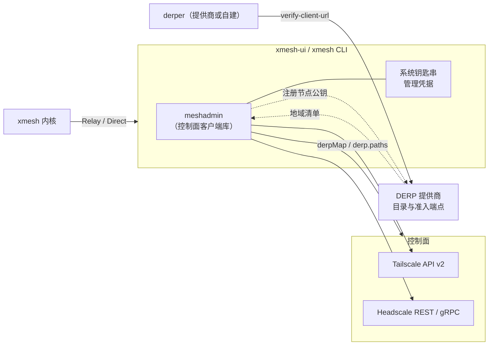

# 13. UI 中的 tailnet 管理与 DERP 提供商路径

本篇是 [12 桌面 UI 与本机控制通道](12-ui-and-control.md) 的延伸，记录两件事：UI 端做 tailscale 管理（主机 tag、权限划分、第三方 DERP 设置），以及这条路径为将来的国内 DERP 提供商业务打下的基础。本篇是方案与研究记录，不含实现，不改阶段 1 到 5 的契约。

日期：2026-10-16。研究依据列在文末。

## 要解决的问题

| 问题 | 现在怎么做 | 痛点 |
| --- | --- | --- |
| 主机 tag | 在控制面管理台手工给节点打 `tag:device`、`tag:peer`、`tag:ingress`、`tag:admin`；auth key 签发时带 tag | 打错或漏打，节点就被 [CTR-AUTHZ-01](../contracts/oauth-authz.md#ctr-authz-01) 或 WhoIs 过滤掉，现象是「设备不出现」，难定位 |
| 权限划分 | 网络层靠控制面 ACL，工具层靠 `agent.authz`（双层授权，见 [CON-SEC-01](../constraints/security.md#con-sec-01)），两处要手工保持一致 | 没有一处能看到「哪个节点能对哪个节点调用哪些工具」 |
| 第三方 DERP | 手写 `derpMap`（官方控制面）或 `derp.urls` / `derp.paths`（Headscale），自建 derper 还要配客户端校验 | 步骤多、易错，[运行手册](../operations.md) 已记录私有 derper 的客户端校验依赖系统 tailscaled |

UI 端的目标是把这三件事变成可预览、可校验、可回滚的操作。

## 研究结论

下列结论的出处见文末。「已核实」表示直接读了官方文档或本仓库依赖的源码（`tailscale.com` v1.104.1）。

### 控制面接口

| 能力 | 官方 Tailscale | Headscale |
| --- | --- | --- |
| 凭据 | API token（最长 90 天）、OAuth client（客户端密钥长期有效，直到撤销）、联合身份（OIDC）。已核实 | API key，默认 90 天过期，只显示一次。已核实 |
| 最小权限 | OAuth scope 可拆分：`devices:core:read`、`devices:core`（改 tag、授权设备，创建时须选定 tag）、`policy_file:read`、`policy_file`、`auth_keys:read`、`auth_keys`。已核实 | 无 scope，API key 即完整权限 |
| 设备与 tag | 设备列表、`SetTags`、授权、路由。官方 Go 客户端 `tailscale.com/client/tailscale/v2` 已封装。已核实 | gRPC 与 REST（`/api/v1`），文档明确覆盖用户、节点、API key。tag 的完整接口以 `/swagger` 为准，未逐项核实 |
| 策略 | `PolicyFile` 的 `Get`、`Raw`、`Set`（带 etag）、`Validate`。已核实 | 策略来自 `policy.path` 文件，改后须 reload（SIGHUP）。v0.29.5 实测：`policy.mode=database` 时 `GET`、`PUT /api/v1/policy` 与 `POST /api/v1/policy/check` 可用；文件模式拒绝 `PUT`。已核实 |
| auth key | `Keys` 创建带 tag、有效期、一次性或可复用的 auth key。已核实 | `POST /api/v1/preauthkey`，`user` 为数字 ID，`aclTags` 带 tag，key 正文只在创建响应出现一次；`POST /api/v1/node/{id}/tags` 改 tag，tag 须在 `tagOwners` 有属主（属主写 `user@`）。v0.29.5 实测，已核实 |

### DERP 事实

- 官方：在策略文件的 `derpMap` 里自定义 region，region ID 限 900 到 999，每个 region 只支持一个 DERP 节点，`OmitDefaultRegions` 可去掉官方 region，把某 region 设为 `null` 可屏蔽它。该能力官方文档标注为 alpha，并说明主要适用于合规场景，多数用户应先考虑 peer relay。已核实。
- Headscale：`derp.urls` 与 `derp.paths` 可合并多份 DERP map，`urls: []` 去掉官方 region，同一 region ID 设为 `null` 可禁用。服务端配置，不是 API。已核实。
- DERP 流量是端到端 WireGuard 加密，中继看不到明文。已核实。官方 DERP 列表有香港，没有列出大陆节点。已核实。
- **准入控制**是商业化的关键：derper 有两种客户端校验。`--verify-clients` 要求 derper 所在机器运行已加入同一 tailnet 的 tailscaled，只能放行该 tailnet 自己的节点，不适合多租户。`--verify-client-url` 让 derper 在每次客户端连接时向一个 HTTP 端点 POST `{NodePublic, Source}`，期望返回 `{Allow: bool}`，源码中该调用有 5 秒超时，`--verify-client-url-fail-open` 默认 `true`（端点不可达时放行）。已按 v1.104.1 源码核实。多租户提供商可以自己实现这个准入端点。
- 上游没有按租户计量：准入只在连接时判断，源码里能看到的是汇总计数、每连接的收发字节（调试页）和一个每客户端限速的配置项。按租户计量和限速要靠 derper 的分叉或旁路统计，限速开关的具体用法待核实。准入拒绝只拦新连接，已建立的连接需要断开才能生效。
- 已有积累：[运行手册](../operations.md) 已有私有 derper 的验证记录，内核的 `Peer` 已带 `Relay` 与 `Direct` 字段，UI 可以直接展示每台设备此刻是直连还是走哪个中继。

### 国内商业化的风险

下面是公开资料的整理，不是法律意见，收费前必须找有电信业务经验的律师确认。

- 工信部 2017 年通知明确，未经电信主管部门批准，不得自建或租用专线（含 VPN）等跨境通道经营跨境业务；合规做法是向有国际出入口局的持证运营商租用。已核实。一家律所的解读称，只有授权基础电信运营商的 VPN 才合法，且只能内部使用。
- 因此，一个收费的中继服务如果承载「境内设备到境外设备」的流量，最容易被归入跨境通道经营。只服务境内设备之间的中继风险较低，但技术上无法保证用户不跨境使用。这一条是整个商业路径的第一风险。
- 面向公众的计费网站和控制台需要域名备案；网上流传的「IP 加自签证书免备案」是个人自用做法，用于收费服务不可靠。
- 个人用户已有大量免费自建教程，商业价值不在中继本身，而在：免配置、准入与计费、多地域、监控与 SLA、和 xmesh 的一键集成。xmesh 的流量是 PTY 与 exec 这类低带宽交互，文件传输是带宽大头，适合按设备数加带宽档位定价。

## 总体方案

要点：

1. **新增 `meshadmin` 库**（根 module 的公开包，不依赖 `internal/`），封装控制面 Provider 接口，两个实现：Tailscale（API v2）和 Headscale。新的 `xmesh mesh ... --json` 子命令是它的入口，Electron 主进程调用该子命令，不用 TypeScript 重写一份，所以管理动作既能点按钮，也能脚本化，将来服务端控制台也能复用。
2. **管理凭据不进内核。** OAuth client 密钥、Headscale API key 存系统钥匙串（Windows 凭据管理器、macOS 钥匙串），只由 `xmesh mesh` 子命令读取（UI 经该子命令间接使用），禁止写进 `xmesh.yaml`，禁止经 Control API 读回，内核进程不持有它们。UI 的登录表单只在保存时把密钥经标准输入交给 `xmesh mesh login --secret-file=-`，主进程与渲染进程不保存、不记录、不回显它，参数里不出现密钥（见 `ui/README.md`）。读写分开签发两份凭据：日常只带只读 scope，要改动时才临时使用写凭据。
3. **不新增身份体系。** xmesh 是控制面的客户端，不是第二套节点身份，符合 [CON-NET-03](../constraints/network.md#con-net-03)。[CON-NET-04](../constraints/network.md#con-net-04) 禁止业务代码里按官方或 Headscale 分支，`meshadmin` 是管理工具，不是业务路径，Provider 的差异只允许出现在这个包里，内核与 Gateway 保持不变。需要在裁定里写明这个界限。

## 能力分期

### 主机 tag

- 设备页列出控制面所有节点，标注 xmesh 角色（agent、gateway、ingress）和 tag，并检查：缺少 `tag:device` 的 Agent、tag 与角色不符的节点、过期的节点密钥。
- 改 tag（Tailscale `SetTags`，须在 `tagOwners` 里有授权；Headscale 走其节点接口），先校验再提交。
- 新设备接入向导：在控制面创建带 tag 的 auth key（默认一次性，可选临时节点），写入目标机器的 `mesh.authkey_file`（`0600`），然后调用 `xmesh install`。auth key 正文只出现一次。

### 权限划分

- 提供「xmesh 权限模板」：个人（设备互通，入口只连设备）、团队（按角色隔离）、受限（入口只能调用指定设备）。模板生成 `tagOwners` 与访问规则，覆盖 Agent 端口 `tcp:7433`、入口到设备、`tag:admin` 到 `/control/drain`。
- 权限矩阵视图合并两层：网络层来自控制面策略，工具层来自各节点的 `agent.authz`，显示「谁可以对谁调用哪些工具」，并标出两层不一致的格子（网络放行但工具层拒绝，或反过来）。
- 写入策略必须经过：差异预览、`Validate`、`If-Match` etag、写前快照、二次确认。Tailscale 策略是带注释的 HuJSON，使用保留注释的解析往返，只改 xmesh 管理的片段，不覆盖用户自己的规则。Headscale 文件模式只能生成文件和 reload 指令，除非 UI 与服务端同机，数据库模式已核实可远程写入（见 [CTR-MESH-01](../contracts/meshadmin.md#ctr-mesh-01)），但写入没有原子的版本检查，见 [RUL-21](../contracts/rulings.md#rul-21)。

### 第三方 DERP 设置

- 设备页展示每台设备当前是直连还是走哪个 DERP region、延迟。数据来自内核 `Peer.Relay` 与 `Peer.Direct`，经 Control API 的 `/v1/peers`（见 12 号文档）。
- DERP 地域编辑：官方控制面写入 `derpMap`（自动分配 900 到 999 的 region ID，避开已有，每 region 一个节点，写入 IPv4 与 IPv6 以抵御 DNS 失败）；Headscale 生成 `derp.paths` 的 YAML，并给出 `derp.urls` 设置。
- 健康探测：对每个 region 检查 TLS 证书与主机名是否匹配、`tcp/443` 与 `udp/3478` 是否可达、延迟，并与官方 region 对比。「只有一个自建 region」时提示单点风险。
- 一键回滚：写入 `derpMap` 前保存快照，探测失败时恢复。

### DERP 提供商集成（商业化基础，需法务确认后再开放）

- **目录**：提供商发布一份带签名的 JSON 目录，含 region 清单、地域、IP 与主机名、状态页和计费入口。UI 导入后走上一节的 `derpMap` 流程。
- **准入**：提供商的 derper 使用 `--verify-client-url` 指向其准入服务。租户在 UI 里授权后，UI 读取租户设备的节点公钥并注册到提供商账户，新增或移除设备时同步更新。准入服务按订阅状态返回 `Allow`。
- **计量**：提供商侧用分叉的 derper 或旁路统计按节点公钥计量，租户在 UI 里查看用量，UI 本地的 `Relay` 统计可作为对账参考。
- **降级**：提供商不可用时，UI 提示并一键切回官方 region 或其他提供商；derper 的 fail-open 默认值由提供商决定，需要在服务条款里写清。
- **隐私**：UI 只上传节点公钥和设备名，不上传工具调用内容，遵守 [INV-10](../constraints/invariants.md#inv-10) 的精神。

## 拆分

沿用 12 号文档的阶段编号，从 U7 起，依赖 U0 到 U3 已完成的控制通道与 Electron 壳。

| 阶段 | 交付 | 依赖 |
| --- | --- | --- |
| U7 meshadmin 契约 | `docs/contracts/meshadmin.md`、Provider 接口、xmesh 权限模板规范、钥匙串存取约束、裁定（Provider 差异只在 `meshadmin`） | U0 |
| U8 只读管理 | Tailscale 与 Headscale 的只读 Provider；设备与 tag 视图、角色检查、权限矩阵、DERP 地域与健康探测、直连或中继展示；`xmesh mesh status` | U7、U1（`/v1/peers`） |
| U9 写管理 | 改 tag、创建 auth key、接入向导、策略写入（预览、校验、etag、快照、回滚）、`derpMap` 与 `derp.paths` 写入 | U8 |
| U10 提供商集成 | 目录格式与签名、节点公钥注册、用量展示、降级。只做客户端侧；服务端准入与计量属于提供商业务，另开仓库 | U9 |

文件归属：`meshadmin/**`、`ui/panel` 的 mesh 页面、`cmd/xmesh/mesh.go`。不触碰 `internal/` 内核包。U7 的文档只追加约束库。

## 验收

| 观察点 | 方法 |
| --- | --- |
| 凭据不泄漏 | 内核进程、`xmesh.yaml`、Control API 响应、审计和日志中搜不到凭据；注入凭据后检查全部输出 |
| 最小权限 | 只读凭据下所有写操作被 Provider 拒绝并给出 scope 提示 |
| 策略安全 | 对包含用户自有规则与注释的策略做往返，只有 xmesh 管理片段变化；etag 冲突时拒绝写入；写后回滚得到原文 |
| Provider 一致 | 同一组场景（打 tag、建 key、生成 DERP 配置）对 Tailscale 与 Headscale 夹具各跑一遍，结果结构一致 |
| DERP 配置 | 生成的 `derpMap` 通过官方控制面 `Validate`；region ID 不冲突；Headscale 生成的 YAML 能被其配置加载（用现有 Headscale 验收环境，见 [验收记录](../validation/2026-10-15-headscale.md)） |
| 探测 | 对一个本地 derper 与一个故意证书不匹配的 derper，探测分别给出通过与具体失败原因 |
| 准入 | 用 `--verify-client-url` 指向测试服务，允许与拒绝的节点各一个，断言拒绝节点无法使用中继 |

## 需要用户决定或提供

- 是否走商业化：U7 到 U9 本身对所有 xmesh 用户都有用，不涉及收费。U10 对外提供（收费或给第三方使用）之前需要律师就境内中继的电信业务许可、跨境风险、备案与日志义务给结论。2026-10-16 用户决定：当前只在小范围内部使用，先不处理法律问题；内部自建准入已按这个范围实现，计量、计费与多租户目录没有做。这一步建议现在就启动，因为它决定 DERP 提供商业务的可行形态。
- 目标控制面：官方 Tailscale 与 Headscale 都做 Provider。若国内版以 Headscale 为主（不受官方 `derpMap` alpha 状态影响，也不依赖境外控制面），U8、U9 的 Headscale 部分要先行，且需要补全 Headscale 的 tag、预授权 key 与数据库策略接口的核实。
- 提供商身份：自己做提供商，还是与现有云厂商合作做 derper 节点。这影响是否需要自建计量与计费。

## 出处

- [Custom DERP servers（Tailscale）](https://tailscale.com/docs/reference/derp-servers/custom-derp-servers)
- [DERP servers（Tailscale）](https://tailscale.com/docs/reference/derp-servers)
- [Trust credentials（Tailscale）](https://tailscale.com/docs/reference/trust-credentials)
- [tailscale.com/client/tailscale/v2](https://pkg.go.dev/tailscale.com/client/tailscale/v2)
- [Headscale API](https://headscale.net/stable/ref/api/)、[DERP](https://headscale.net/stable/ref/derp/)、[Policy](https://headscale.net/stable/ref/policy/)
- 源码：`tailscale.com` v1.104.1 的 `tailcfg/derpmap.go`（`DERPAdmitClientRequest`、`OmitDefaultRegions`）、`cmd/derper/derper.go`（`--verify-clients`、`--verify-client-url`）、`derp/derpserver/derpserver.go`（准入调用与超时、计数器、限速配置）
- [工信部关于清理规范互联网网络接入服务市场的通知（国家网信办转载）](https://www.cac.gov.cn/2017-01/26/c_1120381529.htm)
- [VPN 合规解读（锦天城律师事务所）](https://law.asia/zh-hans/vpn-compliance-china/)
- 国内自建 DERP 教程示例：[ziyue67/tailscale-derp-selfhost](https://github.com/ziyue67/tailscale-derp-selfhost)，其「免备案」说法未给出依据，也未做客户端校验，只作为个人自建做法的参考
