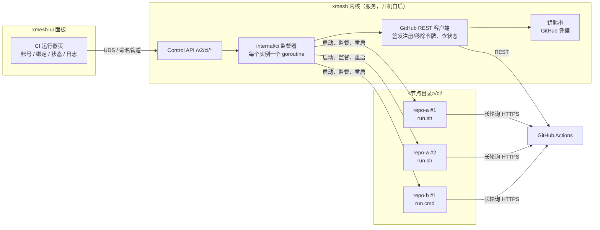

# 15. GitHub Actions 运行器托管

本篇记录 GitHub CI 绑定的方案：让节点内核托管官方 Actions 运行器，在面板里绑定仓库，一台机器可以绑定多个项目并保活，替代在命令行里手动启动运行器。契约部分是 [CTR-CTL-15](../contracts/control.md#ctr-ctl-15)，两者冲突时以契约为准。

日期：2026-10-18。用户已确认的决定见 [已定的决定](#已定的决定)。

## 一句话结论

由 xmesh 内核托管 GitHub 官方的 Actions 运行器（`actions/runner`）：面板里登录 GitHub、勾选仓库即完成绑定；每个绑定是一个由内核监督的运行器进程，崩溃自动重启、开机随内核拉起、内核停止前等任务跑完。一台机器可以绑定任意多个仓库，每个仓库可设并发数。命令行手动 `./run.sh` 的旧运行器可以在面板里直接「导入」接管，不用重新注册。

## 1. GitHub 侧的事实（决定方案形状）

| 事实 | 对方案的影响 |
| --- | --- |
| 一个运行器进程同一时刻只跑一个 job | 「并发数 N」= 同一仓库注册 N 个运行器实例，各自一个目录 |
| 个人账号没有账号级运行器，只有仓库级；组织才有组织级运行器（一个运行器服务组织内多个仓库） | 主路径是「每仓库绑定」；组织级作为可选绑定类型 |
| 注册需要一次性注册令牌（1 小时过期），由 `POST /repos/{o}/{r}/actions/runners/registration-token` 签发，要求对仓库有管理员权限（经典令牌 `repo` 范围；细粒度令牌是仓库的 Administration 读写） | 一键绑定需要一个有管理员权限的 GitHub 凭据；也可以让用户从网页粘贴注册令牌，不留长期凭据 |
| 注册完成后运行器在自己目录里保存自己的凭据（`.runner`、`.credentials`、`.credentials_rsaparams`，Windows 下用 DPAPI 加密），之后连 GitHub 不再需要 PAT | 常驻运行器的保活只需要重启进程，不依赖 PAT 一直可用 |
| 离线超过 14 天的运行器会被 GitHub 自动删除；一次性（ephemeral/JIT）运行器 1 天 | 长期关机的设备回来时需要「重新注册」，有 PAT 时可自动修复 |
| 运行器默认自更新；关闭自更新后必须在新版本发布 30 天内升级，否则不再派任务 | 默认允许自更新，`run.sh`/`run.cmd` 自己处理更新后的重启 |
| 监听进程退出码：0 正常、1 终止错误、2 可重试、3/4 自更新中、5 会话冲突（同名运行器在别处在跑）、6 配置已刷新、7 版本已弃用 | 监督器按退出码分流：重试、换版本、或提示「这个运行器在另一处也在运行」 |
| 支持平台：macOS 11+ x64/arm64，Windows 10/11 x64（arm64 预览），Linux x64/arm64/arm | 覆盖 xmesh 六个发布目标里的全部桌面平台 |
| 自托管运行器跑的是仓库里的任意代码；公开仓库的 fork PR 可以在你的机器上执行代码 | 默认拒绝绑定公开仓库（见第 6 节） |

## 2. 总体结构



为什么放在内核而不是 UI：UI 是可选进程，用户会退出它；内核本来就是 LaunchAgent（`KeepAlive`）/ 登录任务 / systemd 用户服务，开机自启、崩溃被系统拉起。运行器挂在内核下面，等于直接继承这一层保活。UI 只做表单和展示，与现有设计 12 的分工一致。

新增内容一览：

- 内核：`internal/ci`（监督器、运行器安装与注册、GitHub 客户端），配置节 `ci`，Control API `/v2/ci/*`，事件类型 `ci`。
- CLI：`xmesh ci list|status|bind|unbind|start|stop --json`，与 Control API 同一份逻辑，便于无界面的 Linux 机器。
- UI：侧栏新增「CI 运行器」页。
- 契约：`docs/contracts/control.md` 新增 CTR-CTL-1x，`schemas/control-ci.schema.json`，`config.schema.json` 新增 `ci` 节。版本号取实现时 master 上的下一个空号（目前是 1.3，届时可能已被热加载、配对等线递增）。

## 3. 绑定流程（三种入口，全部在面板里完成）

### 3.1 连接 GitHub 账号后一键绑定（主路径）

1. 「CI 运行器」页 →「连接 GitHub」。表单只要一个字段：令牌。表单旁有「去 GitHub 创建令牌」按钮，打开预填好的细粒度令牌创建页（仓库访问选「指定仓库」，权限 Administration 读写、Actions 只读、Metadata 只读），并提示有效期建议选最长或不过期。
2. 令牌经 Control API 写入一次（只写不读，和 PAT 正文同样的规则），内核存进状态目录里的私有目录 `ci-accounts/`（Unix 上 `0700`/`0600`，Windows 上只有运行内核的用户和 SYSTEM 可读，和网关 PAT 同一套 `privdir`），界面之后只显示 `github_pat_…abcd` 掩码、账号名和可访问仓库数。
3. 内核用令牌列出可管理的仓库（有管理员权限的），面板显示列表，带「私有 / 公开」标记和搜索框。
4. 勾选仓库，填可选项（都有默认值）：并发数（默认 1）、附加标签（默认无）、工作目录位置（默认 `<节点目录>/ci/<仓库>/<n>/_work`）。点「绑定」。
5. 内核依次：下载对应平台的运行器包（已有缓存则跳过）并校验 SHA-256 → 签发注册令牌 → 以无人值守方式执行 `config.sh --unattended --url … --token … --name … --labels … --work … --replace` → 启动监督。面板实时显示每一步。

运行器名默认 `xmesh-<节点名>-<n>`，标签默认 `self-hosted, <OS>, <架构>, xmesh, xmesh-<节点名>`。工作流里写 `runs-on: [self-hosted, xmesh-mac]` 就能指定这台机器。

### 3.2 粘贴注册令牌（不想交出长期令牌时）

在 GitHub 仓库 Settings → Actions → Runners → New self-hosted runner 页面复制 `--token` 后面那串，连同仓库地址粘贴进表单。内核注册并开始监督。之后不需要任何 GitHub 凭据。代价：不能列仓库、不能一键解绑（解绑时提示去网页删除，或 14 天后自动消失）、离线超 14 天被删后要重新粘贴。

### 3.3 导入现有运行器（替代命令行启动）

「导入已有运行器」→ 选择目录（例如 `~/actions-runner`）。内核检查目录里的 `.runner` 文件，读出仓库地址和运行器名，确认后接管：以后由内核启动和保活，原目录不搬动。

导入前检查两件事并在面板提示：

- 该目录是否还装着官方的 `svc.sh` / `svc` 服务（launchd `actions.runner.*`、Windows 服务 `actions.runner.*`、systemd 单元）。若有，提示先卸载，否则两个监听进程会抢同一个会话（退出码 5）。卸载需要管理员时，面板给出要执行的命令。
- 该运行器当前是否有人在终端里跑着（进程检测）。若有，提示先关掉那个终端。

导入的运行器没有 xmesh 签发的凭据，也能正常保活；若后来连接了 GitHub 账号，自动获得解绑、自动修复能力。

## 4. 生命周期与保活

每个运行器实例一个状态机：

```
installing → registering → starting → idle ⇄ busy
                              ↑          ↓
                          backoff ← exited
                      stopping → stopped
                      broken（需要用户处理）
```

| 机制 | 做法 |
| --- | --- |
| 崩溃重启 | 进程退出后按指数退避重启：1s、2s、4s … 上限 5 分钟；连续稳定运行 10 分钟后退避清零 |
| 按退出码分流 | 0 且非主动停止：当作异常重启。2：按退避重试。3/4/6：运行器自更新或刷新配置，立即重启。5：会话冲突，停下并提示「这个运行器在别处也在运行」（不无限重试抢会话）。7：版本弃用，自动下载新版本后重启。1 且日志显示「运行器已被删除」：有 GitHub 凭据时自动重新注册，否则进入 broken 并提示 |
| 运行状态 | 解析运行器 stdout 的固定行（`Connected to GitHub`、`Listening for Jobs`、`Running job: …`、`Job … completed with result: …`）得到 idle / busy / 当前 job 名 / 结果，不读任务输出。有 GitHub 凭据时每 60 秒用 API 补充 online/busy 与排队中的工作流数 |
| 开机与登录 | 随内核服务启动。macOS 是 LaunchAgent，需要用户已登录；Windows 是登录任务，需要用户已登录（无人值守的 Windows 需要开启自动登录，面板在 Windows 上提示）；Linux 需要 `loginctl enable-linger`，面板检测并提示 |
| 睡眠 | 可选「运行任务时阻止睡眠」（默认开）：busy 期间 macOS 用 `caffeinate -i -w <pid>`，Windows 用 `SetThreadExecutionState(ES_SYSTEM_REQUIRED)`。空闲时允许睡眠，醒来后运行器自己重连 |
| 内核停止 / 升级 | 运行器在独立进程组（Windows 放进 Job 对象，内核退出时一并结束，避免孤儿）。正常停止或升级前先「排空 CI」：停止所有 idle 实例，等 busy 实例跑完（面板显示「等待 2 个 CI 任务完成」，可点「强制停止」）。超时默认 30 分钟 |
| 内核启动 | 检查上次留下的运行器进程（PID 文件加启动时间比对），残留的结束掉再按配置重新拉起 |
| 配置热加载 | 只对变化的绑定动作：新增→安装注册启动；删除→排空后解绑；并发数变化→增减实例；暂停→排空后停止。其他绑定不受影响 |
| 节点 drain | 节点排空（`/v2/drain`）时 CI 一并排空；`/v2/resume` 恢复。也可以单独暂停 / 恢复某个绑定 |
| 运行器日志 | 运行器自己的 `_diag/` 目录保留，面板提供「打开日志目录」；内核另存每个实例最近 200 行 stdout 的环形缓冲用于诊断，只含运行器状态行，不含任务输出（运行器 stdout 本身不打印任务日志） |

## 5. 运行器包管理

- 版本来源：GitHub `actions/runner` 最新 release；包与校验和都从 release 取。下载目录 `<节点目录>/ci/cache/`，同版本只下一次。
- 每个实例一个完整解压目录（运行器把注册信息写在自己根目录，不能多实例共用）。每个实例解压后数百 MB（实现时实测后写进文案），面板在设置并发数时显示预计占用。
- 默认允许运行器自更新；内核不另做升级。
- 依赖检查：Linux 缺 ICU 等库时，注册前跑 `bin/installdependencies.sh` 的检测部分，缺什么给出命令（需要 root，不自动执行）。macOS、Windows 无额外依赖。`git` 不在 PATH 时提示（`actions/checkout` 会退化为下载压缩包，能跑但慢）。

## 6. 安全

这是全篇最需要讲清楚的部分，写进契约与面板文案。

1. **CI 任务不受 xmesh 工具策略约束。** 运行器以内核运行用户的完整权限执行仓库里的代码，工作目录白名单、禁止目录、L2 沙箱都只约束 MCP 工具调用，不约束 CI 任务。面板绑定时明确提示这一点。它与 L1 `exec.run` 是同一信任级别：谁能往仓库推代码，谁就能在这台机器上以你的身份执行代码。
2. **默认拒绝公开仓库。** 公开仓库的 fork PR 能在你的机器上跑代码。绑定公开仓库需要单独确认，并提示把仓库的「来自外部协作者的 PR 需要批准」设为「所有外部协作者」。
3. **GitHub 凭据只进私有文件**，Control API 只写不读，配置文件只存凭据引用（账号 id）。内核只在签发注册/移除令牌、查状态时读取。
4. **运行器目录自动加入禁止目录**：`<节点目录>/ci/` 默认写进 `cwd-deny.yaml`，MCP 的 fs / exec 工具读不到运行器自己的凭据。
5. **控制通道**：CI 任务和 L1 exec 一样是同用户进程，能连到 `control.sock`。这不增加权限（同用户本来就能改配置文件），但在文档里写明；后续若要隔离，方案是让运行器以独立系统用户运行（见第 10 节可选项）。
6. **审计**：绑定、解绑、启动、停止、重新注册记 `actor=control`；任务开始与结束记仓库、job 名、结果、耗时，不含日志、参数或环境变量（INV-10）。
7. **不提供 MCP 写接口**：远端模型不能绑定或解绑运行器。可选提供只读的 `ci.status` 工具（见第 9 节阶段 4）。

## 7. 配置与控制接口

配置段与路由以 [CTR-CFG-01](../contracts/config.md#ctr-cfg-01) 和 [CTR-CTL-15](../contracts/control.md#ctr-ctl-15) 为准，这里只说设计取舍：

- `xmesh.yaml` 的 `ci` 段只放非密钥信息：账号（id、主机、登录名）与绑定（仓库、账号、并发数、标签、暂停、目录、来源）。GitHub 令牌在状态目录的 `ci-accounts/` 私有文件里，配置、响应、状态、事件、审计都只见掩码。没有用系统钥匙串：内核常常作为服务或开机项运行，那时用户的钥匙串不可用，网关 PAT 也是同样的做法。
- 绑定与账号的修改走与 `PUT /v2/gateway` 相同的配置编辑路径（校验、原子写入、`config` 事件），内核通过配置订阅得到新一代配置，只动变化的绑定。
- 运行状态不另开事件类型：`StatusResponse.ci` 随状态采样变化，UI 从 `status` 事件得到更新，托盘也读同一份。
- 错误沿用已有的错误码，细分原因放在 `reason`（`public_repo_requires_confirm`、`github_rejected`、`account_in_use` 等），不新增顶层错误码。

## 8. 面板

「CI 运行器」页从上到下：

1. **GitHub 账号卡片**：已连接的账号、令牌掩码、到期时间（API 返回时显示）、「更换令牌」「断开」。没有账号时是「连接 GitHub」按钮和两个次要入口「粘贴注册令牌」「导入已有运行器」。
2. **绑定列表**：每行一个仓库：仓库名（点开 GitHub 的运行器页）、实例状态点（空闲 / 运行中 / 重启中 / 需要处理）、当前 job 名、最近一次结果和时间、排队数（有凭据时）、并发数步进器、暂停开关、「⋯」菜单（重启、重新注册、打开日志目录、复制 `runs-on` 片段、解绑）。
3. **添加绑定**抽屉：仓库搜索勾选、并发数、标签、高级（工作目录、阻止睡眠）。公开仓库勾选时弹确认。
4. **需要处理**横幅：会话冲突、运行器被 GitHub 删除且无凭据、Linux 缺依赖、Windows 未开自动登录等，各自给出一步可操作的按钮或要执行的命令。

托盘菜单加一行状态「CI：2 个运行中 / 3 个空闲」，有 broken 实例时托盘图标显示警告；停止内核或退出时若有 busy 任务，先弹「有 CI 任务正在运行」确认。

## 9. 阶段与 PR 拆分

| 阶段 | 内容 | 依赖 |
| --- | --- | --- |
| 1. 契约 | control.md 新章节、`control-ci.schema.json`、`config.schema.json` 的 `ci` 节、正反例夹具、生成 UI 类型（API 1.8） | 无 |
| 2. 内核监督器 | `internal/ci`：包下载与校验、注册（注册令牌方式）、导入、状态机、退避、退出码分流、stdout 解析、进程组 / Job 对象、排空、热加载对接、阻止睡眠；`xmesh ci` 子命令 | 1 |
| 3. GitHub 账号 | 私有文件存取令牌、列仓库、签发注册与移除令牌、状态轮询、自动重新注册、解绑清理 | 2 |
| 4. 面板 | CI 运行器页、托盘状态与退出确认、假内核夹具、Playwright 用例 | 1（可与 2、3 并行，用假内核） |
| 5. 实机验收 | Mac 与 Windows 各绑定一个私有测试仓库，跑一个推送触发的工作流；杀进程看自动重启；重启电脑看自动恢复；任务中停止内核看排空；导入一个手工配置的运行器 | 2–4，Mac 需要用户在 GitHub 网页上看一眼结果 |
| 可选 | 组织级绑定；每任务一次性运行器（JIT，每个 job 一个干净运行器）；只读 MCP 工具 `ci.status`；以独立系统用户运行运行器 | 以后按需 |

阶段 1 到 4 都是常规 PR，CI 全绿即合并，计划随 beta.4 发布。

## 10. 考虑过但没选的做法

- **在 UI（Electron）里托管运行器**：UI 退出运行器就停，违背保活目标。
- **调用运行器自带的 `svc.sh` / Windows 服务安装**：每个运行器一个系统服务，Windows 上要管理员，macOS 上散落多个 LaunchAgent，xmesh 无法统一展示状态和排空，卸载也容易留残。只作为「导入时发现并提示卸载」的对象。
- **默认每任务一次性运行器（JIT）**：每次都要用管理员级令牌向 GitHub 签发配置，PAT 必须一直可读；个人机器上工作区干净度收益不大。保留为可选模式。
- **自己实现 Actions 协议替代官方运行器**：协议未公开、变化快，维护不可承受。
- **复用 `gh` CLI 的登录令牌**：读取别的程序的凭据，权限范围也过宽（经典 `repo`）。不做自动读取；用户愿意可以把令牌粘进表单。

## 11. 已定的决定

用户于 2026-10-18 确认全部按推荐项：

1. GitHub 凭据用细粒度个人令牌（面板一键打开创建页，粘贴一次）。「用 GitHub 登录」的设备码流程需要先创建 GitHub App，以后再追加。
2. 公开仓库默认拒绝，二次确认后才允许绑定。
3. 常驻运行器；每个任务用一次性运行器（JIT）留作以后的选项。

现有手动运行器的位置等实机验收时再问，用来测「导入」。

## 12. 验收标准

- 面板里从零绑定一个私有仓库，全程不打开终端、不改 YAML；工作流推送后在该机器上跑完。
- 一台机器同时绑定至少两个仓库，其中一个并发数 2，同时触发三个 job 都在本机并行执行。
- 杀掉运行器进程，5 秒内自动重启并重新 `Listening for Jobs`；连续崩溃时退避生效、面板显示重启次数。
- 重启电脑并登录后，所有未暂停的绑定自动恢复在线，无需打开面板。
- 任务进行中点「停止内核」：面板提示等待，任务跑完后才停止；「强制停止」立即停止。
- 导入一个手工 `config.sh` 配置的运行器，导入后关掉原终端，运行器仍在线并能接任务。
- 解绑后 GitHub 运行器页上该运行器消失（有凭据时）。
- 配置文件、审计、事件、日志中都找不到令牌正文和任务输出。
