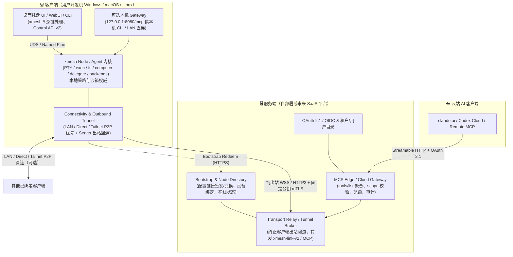
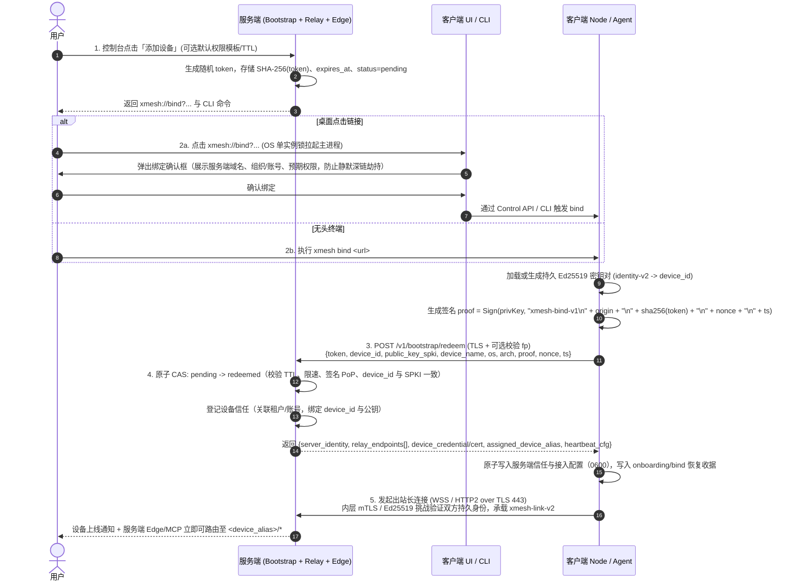

# 21. 架构演进 RFC：服务端/客户端拆分、配置链接一键绑定与 SaaS 转发平台准备

- **状态**：已拍板定稿（对应 `tzf1003/xmesh#223`，第 5 节五项核心架构取舍已由用户全部采纳推荐方案确认；本 PR 仅定稿架构文档，**不修改业务代码**，后续按第 6 节分阶段开 issue 落地）
- **基线**：`master`（`a651876`）
- **目标读者**：项目维护者与协作 Agent

本文档围绕三个核心议题，基于当前仓库真实代码与契约文档梳理耦合点、对比拆分方案、给出配置链接一键绑定与面向未来多租户 SaaS 转发平台的最小预留抽象，并记录**已拍板**的 5 项关键架构取舍及后续分阶段实施 issue 拆分建议。

---

## 1. 现状耦合点梳理（基于代码与契约）

当前设计（[02 整体架构](02-architecture.md)、[架构与角色约束](../constraints/architecture.md)）采用「每台设备运行同一个 `xmesh` 进程，按 `node.roles` 叠加角色」的一体化模型。在个人自部署小规模场景下，这简化了分发，但也形成了四类显著耦合：

### 1.1 进程、模块与配置耦合（控制面 / 数据面 / 角色同进程）

1. **单二进制与单模块强约束**：
   - [CON-ARCH-02](../constraints/architecture.md#con-arch-02) 与 [CON-ARCH-03](../constraints/architecture.md#con-arch-03) 规定整个仓库只能有一个 `go.mod` 与唯一的 `main` 包（[`cmd/xmesh`](../../cmd/xmesh/main.go)），并通过 [`cmd/xmesh/conformance_arch_test.go`](../../cmd/xmesh/conformance_arch_test.go) 中的 `Test_CONARCH02_SingleModuleSingleBinary` 在 CI 中静态拦截新增 `cmd/*` 或多 `go.mod`。
   - 后果：一个面向服务端部署的 Linux 公网入口节点，不得不携带 Windows AppContainer（`internal/winbox`、`internal/winjob`）、本地 PTY/exec/fs 执行器、桌面执行器维护（`internal/computer`）与托盘控制通道；反之，用户开发机上的客户端二进制也必须打包完整的 OAuth 2.1 服务端（`internal/oauth`）、ACME 证书申请（`autocert`）、Tailscale/Headscale 控制面管理客户端（`meshadmin`）与公网直连防扫描卫兵（`internal/connectivity/guard.go`）。

2. **运行时装配与跨角色内存耦合**：
   - [`internal/app/runtime.go`](../../internal/app/runtime.go) 的 `Run()` 在单进程内同时装配：`connectivity.Open`（或 `mesh.Network`）、`agent.New`、`roleRuntime`（[`internal/app/roles.go`](../../internal/app/roles.go) 管理 `gatewayRole` 与 `ingressRole`）、`startCI`（`internal/ci`）与 `startControl`（[`internal/app/control.go`](../../internal/app/control.go)）。
   - **共享内存队列与通道**：
     - [`gatewayRegistry`](../../internal/app/gateway_role.go#L24-L90) 将本机 `Gateway` 与同进程 `Ingress` 内置的 `gateway.Gateway` 放在同一个注册表里同步 `drain` 状态。
     - `dialPeer`（[`internal/app/runtime.go`](../../internal/app/runtime.go#L255-L278)）在同进程内对 `localPeer.ID` 走 `a.Transport(...)`（内存直连），对远端走 `devices.Transport(...)`；`localAgentPrincipal` 把 `p.Ingress` 直接改写成 `tag:ingress`。
     - `fanoutMeshChanges`（[`internal/app/runtime.go`](../../internal/app/runtime.go#L377-L401)）把单一网络层通知扇出给本机 `Gateway` 与 `Ingress`。
   - **PTY 跨主机准入挂在 Agent 侧**：[`PTYBudget`](../../internal/role/gateway/pty_budget_authority.go) 允许 `Ingress` 通过配置 `ingress.pty_budget_authority` 向某个指定 `Agent` 节点的 MCP Resource（`pty.BudgetAuthorityURI`）申请跨主机 PTY 准入租约（由 `Agent.BudgetAuthority` 持有状态），控制面准入状态与工具执行节点交织在一起。

3. **单一配置与状态目录模型**：
   - [`internal/config/config.go`](../../internal/config/config.go#L29-L38) 的 `Config` 结构体将 `Node`、`Mesh`、`Gateway`、`Ingress`、`Agent`、`Audit`、`CI` 全部合并在同一个 `xmesh.yaml`（`schema_version: 2`）中，由 `config.Store` 统一热加载与 `Subscribe`。
   - [`internal/connectivity/node.go`](../../internal/connectivity/node.go#L179) 对 `stateDir` 持有互斥文件锁 `device-runtime.lock`，使得同一节点目录无法拆分为独立进程生命周期的客户端代理与入口服务。

4. **桌面 UI / WebUI 与内核绑定形态**：
   - [`ui/electron-builder.config.mjs`](../../ui/electron-builder.config.mjs) 将 Go 内核 `xmesh`（以及 Windows `xmesh-background.exe`）和 `xmesh-computer` 打包进 Electron 的 `resources/bin/`。
   - [`ui/src/main/cli.ts`](../../ui/src/main/cli.ts) 通过 `execFile` 调用 `xmesh` CLI（`start`/`stop`/`restart` 等），并通过 UDS / Windows 命名管道访问 `internal/control`（Control API v2）。这种「UI ↔ 本机 Control API ↔ 本机 CLI」的边界本身是解耦的，可直接作为未来「客户端壳」与「客户端内核」的标准分界继续复用。

### 1.2 网络与传输层耦合（Tailnet / Headscale / LAN / Direct / Cloudflare）

1. **传输路径全量内嵌在 `connectivity.Node`**：
   - [`internal/connectivity/node.go`](../../internal/connectivity/node.go) 同时管理 `lan`（`internal/mdns` + mTLS）、`tailnet`（[`internal/mesh/tailnet.go`](../../internal/mesh/tailnet.go) 内嵌 `tsnet.Server`）、`direct`（[`internal/connectivity/direct.go`](../../internal/connectivity/direct.go) 公网监听 + `guard.go` 预认证防护）和 `cloudflare`（[`internal/connectivity/cloudflare.go`](../../internal/connectivity/cloudflare.go) 拉起并托管 `cloudflared` 子进程）。
   - [`internal/devicelink/manager.go`](../../internal/devicelink/manager.go) 在 `/mesh/v2/link`（子协议 `xmesh-link-v2`）上维护双向双槽 carrier、`Epoch` 仲裁、smart 路径打分与 120 秒会话恢复窗口。这部分传输与多路复用核心非常扎实，但目前**缺少一个「纯客户端出站回连服务端中继」的通用路径类型**。

2. **对外部基础设施的前置强依赖**：
   - 使用 `tailnet` 时，用户必须自备 Tailscale 账号或自建 Headscale + 自建 DERP；在当前 `meshadmin`（[`meshadmin/`](../../meshadmin/doc.go)）设计中，尽管包级别遵守 [CON-MESH-01](../constraints/meshadmin.md#con-mesh-01) 不被 `internal/` 引用，但仍由用户桌面端/CLI（[`cmd/xmesh/mesh.go`](../../cmd/xmesh/mesh.go)）直接持有整个 tailnet 的控制面高权限凭据（`0600` 文件或系统钥匙串），负责改 `tagOwners`、写 `derpMap`、签发 `preauthkey`。
   - 使用 `cloudflare` 时，用户需要持有 Cloudflare 账号 API Token（`internal/cfadmin`），且每台被连接设备都要运行一条独立隧道和外部 `cloudflared` 进程。
   - [CON-NET-08](../constraints/network.md#con-net-08) 当前明确**禁止实现 `mesh.mode: relay`**，即仓库里目前不存在「客户端只做出站连接、由 xmesh 自己的服务端承担转发」的通道实现。

### 1.3 设备配对、邀请码与 OAuth / PAT 耦合

1. **现有配对强依赖「事先已有可达地址」**：
   - [`internal/device/pairing.go`](../../internal/device/pairing.go) 基于 `device_id`（`dev-` + `SHA-256(SPKI)`）和独立引导 ALPN `xmesh-pair/2`（`/mesh/v2/pair/{identity,challenge,exchange,confirm}`）完成 SPAKE2（ristretto255 + Argon2id）配对。
   - 痛点：无论走密码配对还是 `xmesh pair --export/--import`，前提都是双方已经处于同一 LAN，或者已接入同一 Tailnet，或者至少一方开放了公网 `direct` 端口 / Cloudflare Tunnel。对于刚装好客户端、身处公司或家用 NAT 后的普通用户，**没有「服务端出一条链接，点一下就自动入网并回连」的零配置入口**。

2. **现有最接近「一键加入」的实现局限**：
   - [`cmd/xmesh/cloudflare_invite.go`](../../cmd/xmesh/cloudflare_invite.go) 与 [`internal/cfadmin/invite.go`](../../internal/cfadmin/invite.go) 提供了 `xmesh cloudflare invite` + `xmesh join`：把 `Admin`、`Fingerprint`、`Password`、`Hostname`、`TunnelToken`、`AccessID`、`AccessKey` 打成一个最长 8 KiB 的 `xmesh-join-<base64url>` 字符串（15 分钟有效）。
   - 其耦合与限制包括：(a) 强绑定 Cloudflare Tunnel 与发送方的 Cloudflare API 凭据；(b) 邀请方命令必须挂起轮询 `Trusted()` 并在完成后手动修改本地 `mesh.cloudflare.peers`（还要重启生效）；(c) 需要提前知道并强校验新设备的 `cfg.Node.Name`；(d) 无法作为服务端通用引导协议。
   - [`internal/connectivity/offers.go`](../../internal/connectivity/offers.go)（`/mesh/v2/offer`、`collect`、`ack`）虽然支持异步下发 `cloudflare` 与 `tailnet` 连接方式提议，但**只对已信任设备开放**（`trustedCaller` 校验 mTLS 证书），不能用于未绑定设备的冷启动。

3. **OAuth / PAT 与单租户模型耦合**：
   - [`internal/oauth/server.go`](../../internal/oauth/server.go) 遵守 [CON-ARCH-07](../constraints/architecture.md#con-arch-07) 的单主体假设：仅校验一份本地 `oauth-password` 哈希，客户端与令牌分别落盘在单机 `oauth-clients.json` 和 `oauth-tokens.json`，没有用户、组织或租户概念。
   - [`internal/role/gateway/local_auth.go`](../../internal/role/gateway/local_auth.go) 的 `LocalAuthentication` 依赖读取本地文件系统上的 `pat.TokenFile`，与 `gateway.access`、`gateway.hosts` 耦合。
   - 目标设备 `Agent` 侧（[`internal/role/agent/agent.go`](../../internal/role/agent/agent.go#L469-L519)）完全依赖网络层传来的 `Principal.Tags`（`tag:ingress`、`tag:peer` 等）做 `agent.authz` 鉴权，在集中式/SaaS 环境下，必须把「平台用户/租户身份与设备归属」和「节点级角色标签」解耦。

---

## 2. 服务端 vs 客户端拆分方案

### 2.1 职责边界重划

拆分后不再要求所有机器跑同一个全能角色集合，而是按**状态权威**与**网络位置**切分为**服务端（Control Plane + Relay + Edge）**与**客户端（Device Node / Agent / Local UI）**：



核心归属原则：
1. **客户端永远是执行态与安全边界的唯一权威**（延续 [INV-03](../constraints/invariants.md#inv-03)、[CON-ARCH-04](../constraints/architecture.md#con-arch-04)）：PTY、exec、租约、文件分块、工作目录 `cwd_policy`、命令黑名单、L2 沙箱、本地 `agent.authz` 只留在客户端。
2. **服务端无执行态、只管控制面与路由转发**：服务端不持有任何设备上的 PTY 状态或本地文件锁，只持有用户/租户账号、设备注册关系（`device_id` ↔ 公钥 ↔ 归属）、引导令牌、OAuth 2.1 会话与中继转发表。
3. **本机 `Gateway` 仍可作为客户端轻量能力保留**：本机 Claude Code / Codex CLI 以及同局域网设备互联仍走本机 `Gateway`（满足 [CON-ARCH-08](../constraints/architecture.md#con-arch-08)，不强制绕行远程服务端）；而面向公网/云端 AI 的 `Ingress` 与多设备引导协调收敛进服务端。

### 2.2 三种工程拆分方案对比

| 维度 | 方案 A：单仓多二进制 + 共享核心包（Monorepo Multi-Binary） | 方案 B：单仓单二进制 + 严格内部分层 | 方案 C：拆分为独立仓库（Multi-Repo） |
| --- | --- | --- | --- |
| **仓库与 Module** | 单仓单 `go.mod`（或 `go.work`），`cmd/xmesh`（客户端）与 `cmd/xmesh-server`（服务端）共存 | 保留唯一 `cmd/xmesh`，仅新增 `xmesh server` 子命令与独立 `internal/server` | 客户端仓与服务端仓完全分离，各自独立 `go.mod` |
| **构建产物** | 客户端 `xmesh`（6 平台交叉编译，移除服务端重依赖）+ 服务端 `xmesh-server`（专注 Linux amd64/arm64 + 容器镜像） | 仍产出单一全平台二进制，客户端体积包含全部服务端/控制台逻辑 | 两套发布流水线，客户端含 Go+Electron+Rust，服务端仅 Go/Web |
| **代码与契约共享** | 直接共享 `internal/devicelink`、`internal/mcpmux`、`internal/device`（身份/TLS）、`api/` 契约包与联合集成测试 | 同 A，完全共享 | 必须抽离独立协议/Schema 仓库或 Go module，跨仓改字段需要双边 PR 与版本锁步 |
| **依赖与安全隔离** | 编译期即可隔离：客户端不链接服务端 DB/多租户/公网证书管理；服务端不链接 `winbox`/`pty`/`computer` | 运行期隔离，但静态扫描和供应链漏洞（如服务端 Web/DB 依赖）仍落在客户端包内 | 物理彻底隔离，权限与仓库访问控制最干净 |
| **对现有架构约束的影响** | 需微调 `CON-ARCH-02`（允许 `cmd/` 有客户端和服务端两个二进制）与 `Test_CONARCH02_SingleModuleSingleBinary`；不打破本地调试体验 | 形式上不改 `CON-ARCH-02`，但实际上无法解决二进制职责臃肿与未来 SaaS 服务端演进 | 彻底推翻 `CON-ARCH-02`，破坏当前 `scripts/conformance_check.py` 与 `go test -race ./...` 端到端链路测试 |
| **迁移成本** | **中低**：可渐进式从 `internal/app` 抽离服务端职责，本地端到端测试可继续在一仓内跑通 | **低**：改动最小，但后期拆 SaaS 仍要再拆一次 | **高**：当前 `internal/app`、`internal/config`、`internal/connectivity` 耦合未解开前强拆仓会造成大量重复与维护停滞 |

### 2.3 推荐演进路线（先 A 后按需演化）

**推荐路线：一期采用「方案 A（单仓多二进制 + 边界隔离）」，并保留面向方案 C 演进的包边界。**

具体拆分步骤（分三步走，先不动已有单机体验）：
1. **第一步：抽取共享协议与传输底座（不改二进制数量也可先行）**
   - 将设备身份/TLS 校验（`internal/device`）、传输帧与会话复用（`internal/devicelink`）、MCP 前缀复用（`internal/mcpmux`）、结构化错误（`internal/toolerr`）整理为「客户端与服务端共同依赖的纯协议/核心层」，确保服务端代码绝对不导入 `internal/role/agent`、`internal/pty`、`internal/exec`、`internal/winbox`、`internal/computer`、`internal/sandbox`。
2. **第二步：单仓拆出客户端与服务端两个二进制**
   - **客户端二进制 `cmd/xmesh`**：包含 `Agent`、本地可选 `Gateway`、`connectivity`（LAN/Direct/Tailnet + 新增 Outbound Tunnel Client）、`control`（UDS/Named Pipe）、`setup`/`bind`、`service` 管理。体积更小、无需 ACME / 服务端存储依赖。
   - **服务端二进制 `cmd/xmesh-server`**：包含公网 MCP `Edge/Ingress`、OAuth 2.1 授权服务器、Bootstrap 引导令牌服务、节点注册表/目录、出站隧道聚合 `Relay/Broker`、以及可选的 `meshadmin` 控制面编排能力。专注 Linux 容器化发布。
   - **本地兼容**：对于习惯原有一条命令自部署的用户，`xmesh-server` 可与本机 `xmesh` 通过回环配置或 `docker-compose` 组合；过渡期可保留旧 `serve --ingress` 兼容入口直至 `cmd/xmesh-server` 完成端到端验收后下线。
3. **第三步（未来 SaaS 扩张期）**：
   - 当托管 SaaS 服务端需要引入独立的前端控制台、多节点调度、计费数据库（如 Postgres/Redis）与独立运维发布节奏时，因为第二步已经把协议契约与实现包隔离清楚，此时可平滑将 SaaS 业务控制面迁出至独立仓库，只保留 `xmesh-link` / `bootstrap` / `mcp` 协议包作为跨仓契约。

---

## 3. 极简快速绑定（配置链接一键拉起回连）协议草案

### 3.1 设计目标与核心取舍

目标：用**一条链接（或等价的一条命令）**替代当前「配置 Tailscale/Cloudflare + 手工换公钥指纹 + 编辑 YAML + 手工开端口」的繁琐流程，让客户端在 NAT 后、无公网 IP、零手工改配置的前提下安全上线并绑定到指定服务端。

采用 **「短引用型一次性引导链接（Reference Bootstrap Link）」**：链接本身**不携带长期隧道凭证或复杂配置**（区别于 `cfadmin.Invite`），只携带定位服务端与兑换凭据所需的最小信息，所有正式身份绑定和端点配置在 TLS 通道内实时协商并原子兑换。

### 3.2 URL / Token 格式草案

提供两种等价形态，适配桌面点击拉起与无头终端粘贴：

1. **桌面 Deep Link（URL Scheme）**：
   ```text
   xmesh://bind?v=1&server=https%3A%2F%2Fedge.example.com&token=xmb1_<32字节Base64URL随机数>&fp=<可选_64位hex_SPKI_SHA256>
   ```
2. **Web / CLI 通用引导 URL（HTTPS Fallback）**：
   ```text
   https://edge.example.com/bind#v=1&token=xmb1_<32字节Base64URL随机数>&fp=<可选_64位hex_SPKI_SHA256>
   ```
   - 浏览器打开该 HTTPS 页面时，尝试触发 `xmesh://bind?...` 拉起桌面客户端，同时展示一行可直接复制的 CLI 命令：
     ```bash
     xmesh bind "https://edge.example.com/bind#v=1&token=xmb1_...&fp=..."
     ```
   - 敏感参数放在 fragment（`#`）中（当走 HTTPS 分享链接时），避免 HTTP 请求把一次性引导 token 泄漏到 CDN/代理访问日志或 `Referer` 头；在 `xmesh://` 深链或 CLI 兑换时，token 只通过 `POST` JSON 请求体发送。

字段定义：

| 字段 | 必填 | 约束与作用 |
| --- | --- | --- |
| `v` | 是 | 协议版本，当前固定 `1` |
| `server` | Deep Link 必填 | 服务端 HTTPS 根源（必须为 `https://`，仅本地开发允许显式 `--allow-insecure-http` 环回测试；拒绝用户信息/多余路径） |
| `token` | 是 | 前缀 `xmb1_` + 至少 192 bit（24–32 字节）密码学随机串；服务端仅保存 `SHA-256(token)` |
| `fp` | 强烈建议 | 服务端连接证书的 SPKI SHA-256 指纹（64 hex 或前缀），用于在证书钉扎或自签环境防中间人攻击 |

### 3.3 端到端交互时序



### 3.4 安全边界、异常与失败恢复协议

1. **安全边界**：
   - **一次性与防重放**：服务端对 `token_hash` 使用原子状态转移（`pending` → `redeemed`），TTL 默认 10 分钟；已消费或过期令牌返回 `410 Gone`（错误码 `bootstrap_token_used` / `bootstrap_token_expired`）。
   - **防静默深链劫持（Deep Link CSRF）**：桌面端 `ui/` 主进程注册 `xmesh://` 协议后，**禁止在未弹窗确认的情况下自动兑换或写入服务端地址**；确认框必须清晰展示 `server` 域名（Punycode 解码校验）、是否在目标服务端做过指纹校验（`fp`），并要求用户显式点击确认。
   - **防爆破与枚举**：`/v1/bootstrap/redeem` 沿用 [CON-SEC-11](../constraints/security.md#con-sec-11) 策略按源 IP 严格限速（如每分钟每 IP 最多 5 次失败即锁定退避），且区分不了「token 不存在」与「已过期/错误」的响应时间（或统一错误时延），防止枚举。
   - **持有证明（Proof-of-Possession）**：兑换请求必须附带客户端设备私钥的签名，防止网络中间人或日志泄漏场景下把别人刚生成的 `device_id` 抢注到攻击者名下。
   - **权限最小化**：绑定成功只建立「服务端 ↔ 设备」的传输信任与节点目录登记；客户端工作目录（`cwd_policy`）、命令权限（开发/只读）与 `agent.authz` 仍必须在客户端本地显式配置（GUI 确认或 CLI 参数 `--workspace` / `--permission`），服务端不能通过绑定响应静默扩大设备本地的文件/命令执行权限。

2. **失败恢复协议**：
   - **网络丢包导致回执未收到（半成功状态）**：若服务端已将 `token` 置为 `redeemed`，但客户端因断网未收到响应，服务端保留一个短暂的幂等宽限期（如 60 秒）：**仅当同一个 `device_id` 且携带合法新签名 PoP 再次请求 `/v1/bootstrap/redeem` 时**，幂等返回绑定结果；若为不同 `device_id`，立即拒绝并告警。
   - **本地落盘失败 / 崩溃恢复**：复用 `internal/onboarding` 的持久化任务锁与恢复收据思想——兑换成功后，若客户端在写入配置或安装常驻服务时失败，客户端已保存 `device_id` 私钥，重启或运行 `xmesh bind --resume` 时**优先尝试直接用设备私钥向服务端认证拉取最新接入配置**（无需再次消费一次性的 bootstrap token）。
   - **出站长连接断线重连**：采用指数退避（1s → 2s → 4s → … 上限 30s + 随机抖动），复用 `devicelink` 的会话恢复窗口语义；服务端吊销设备绑定或切换设备公钥后，立即关闭活跃隧道并返回永久拒绝码（如 `403 device_revoked`），客户端停止重连并提示用户重新绑定。
   - **NAT 与代理穿透**：出站连接默认复用 HTTPS 443（WebSocket over TLS 或 HTTP/2），天然兼容企业防火墙与 HTTP 代理；若同时存在 LAN / Direct / Tailnet P2P 路径，沿用现有 `smart` 路径选择器优先直连，服务端隧道作为默认且零配置的保底与公网 MCP 回连路径。

---

## 4. 面向未来 SaaS 多租户转发平台的演进准备

根据 [11 已决事项](11-decisions.md) 与 [13 tailnet 管理与 DERP 提供商路径](13-mesh-admin-and-derp.md)，当前个人单租户架构不直接包含计费与跨租户商业运营，但为了避免拆出服务端后推倒重来，应在接口与数据模型层预留以下 **5 项最小抽象**：

1. **租户与主体上下文抽象（`TenantContext`）**
   - 现状：`internal/oauth/server.go` 为单口令单用户；`agent.authz` 仅识别全局 `tag:*`。
   - 预留抽象：在服务端身份与授权上下文中引入一等字段 `TenantID`（或 `WorkspaceID`）与 `SubjectID`（用户 ID / OAuth Client ID）。
   - 路由与隔离不变量：**所有设备索引、Token 校验、OAuth Client 注册表、隧道转发表必须以 `(TenantID, DeviceID)` 为联合主键**，严禁跨租户通过设备别名路由（即使两个租户都有一台叫 `mac-m3` 的设备）。
   - 设备端保持纯粹：客户端仍只认「自己绑定的服务端主体/租户身份 + 本地 `agent.authz` 策略」，不感知其他租户存在。

2. **可插拔传输与服务端出站中继抽象（为解除 `CON-NET-08` 铺路）**
   - 现状：`connectivity.Node` 硬编码四种路径（`lan` / `tailnet` / `direct` / `cloudflare`），`CON-NET-08` 禁止 `relay`。
   - 预留抽象：将客户端传输抽象为统一接口（`OutboundDialer` / `LinkCarrier`），把「连向服务端的出站反向隧道」作为标准传输实现之一（例如未来受控的 `server_relay` / `relay` 通道，在服务端侧承担与 `cloudflared` / `derper` 对等的出站接入功能，但无需用户自己买域名、装 `cloudflared` 或部署 Headscale）。
   - 多租户转发路径：外部云端 Agent（Claude Cloud / Codex Cloud）→ 平台公网 Edge（OAuth 2.1 + 租户路由）→ 平台内网/同节点 Relay Hub → 客户端主动建立的出站加密隧道 → 目标设备 `Agent`。

3. **端到端与零信任边界抽象（防平台越权与密钥隔离）**
   - 沿用「平台层准入 + 设备层本地策略」双层校验（[CON-SEC-01](../constraints/security.md#con-sec-01)）：即使平台侧凭据或某个 OAuth Token 泄漏，未在设备本地 `cwd_policy`、`agent.authz`、`agent.policy` 中放行的目录或工具依然被设备端拒绝。
   - **零信任加密扩展位**：在隧道握手与逻辑会话层预留外层传输加密（设备 ↔ 平台 Edge mTLS）与可选内层负载加密封装位（供未来支持用户自托管虚拟网关或端到端加密透传，避免协议帧头锁死只能明文经平台）。

4. **无状态边缘 + 有状态设备的计量与配额钩子（Quota & Metering Hooks）**
   - 现状：`internal/quota/quota.go` 仅单机内存计数；`internal/role/gateway/pty_budget_authority.go` 依赖单点 Agent。
   - 预留抽象：在服务端 Edge 与 Relay 入口层定义 `AdmissionHook`（连入前校验：租户并发设备上限、单设备活跃隧道数、套餐权限）与 `UsageEmitter`（仅发射脱敏计量事件：`tenant_id`、`device_id`、`tool_group`、请求计数、`rx_bytes`/`tx_bytes`、PTY 活跃时长），严禁采集业务正文、路径内容与终端字节流（守住 [INV-10](../constraints/invariants.md#inv-10)）。

5. **平台可观测性与关联追踪（Audit & Trace）**
   - 在协议信封中预留只读关联字段 `trace_id`（与现有 `oauth_session` 脱敏哈希并行），使服务端平台侧的连接/转发日志与客户端本地的 `audit/*.jsonl` 能按请求 ID 对账排障，同时保持两者存储隔离。

---

## 5. 已拍板的关键架构取舍（Approved Decisions）

以下 **5 项关键架构取舍**已由用户拍板确认，**全部采纳推荐方案（选项 A）**，作为后续契约修订与分阶段实施的唯一基线：

| 编号 | 议题 | 最终拍板结论 | 对既有约束 / 契约的影响 |
| --- | --- | --- | --- |
| **决策 1** | 仓库与构建产物拆分 | **已拍板 → 选项 A：单仓多二进制**（`cmd/xmesh` 客户端 + `cmd/xmesh-server` 服务端，共享核心协议与契约包） | 后续修订 [CON-ARCH-02](../constraints/architecture.md#con-arch-02)、[CON-ARCH-03](../constraints/architecture.md#con-arch-03) 与 `Test_CONARCH02_SingleModuleSingleBinary` |
| **决策 2** | 一键配置链接载荷模型 | **已拍板 → 选项 A：短引用一次性链接**（`xmesh://bind` / `https://.../bind#...`）+ **保留离线配对**（`xmesh pair`）兜底 | 后续新增 Bootstrap 契约与 Schema，逐步收口现有 `xmesh cloudflare invite` 长码模型 |
| **决策 3** | 跨网 / NAT 回连底层 | **已拍板 → 选项 A：原生出站 WSS / HTTP2 + 固定公钥 mTLS 443 隧道**（承载 `xmesh-link-v2`，保留 P2P 优先） | 后续修订 [CON-NET-08](../constraints/network.md#con-net-08)，允许定义受控的出站中继通道 |
| **决策 4** | SaaS 一期安全与可见性模型 | **已拍板 → 选项 A：平台终止 MCP Edge + 元数据零留存**，设备保留本地最终裁决，协议预留 **E2EE 扩展位** | 延续 [INV-10](../constraints/invariants.md#inv-10) 与 [CON-SEC-01](../constraints/security.md#con-sec-01)；后续补多租户隔离契约 |
| **决策 5** | 客户端本地 `Gateway` 去留 | **已拍板 → 选项 A：保留轻量可选本机 `Gateway`**（继续支持本机 CLI 与 LAN 直连） | 保持 [CON-ARCH-08](../constraints/architecture.md#con-arch-08) 不变 |

### 决策 1：仓库、构建产物与代码拆分形态（已拍板：选项 A）
- [x] **已采纳选项 A：单仓多二进制（Monorepo Multi-Binary）**
  - 同一个 `go.mod` 下拆分为客户端 `cmd/xmesh` 与服务端 `cmd/xmesh-server`（各自剥离无关平台重依赖），共享协议、身份、传输与契约测试；后续 SaaS 业务与控制台膨胀后再按需独立建仓。
- 备选参考（未采纳）：选项 B（保持单仓单二进制仅做内部分层）、选项 C（立即拆分为独立仓库）。

### 决策 2：一键配置链接的载荷模型与离线兼容性（已拍板：选项 A）
- [x] **已采纳选项 A：在线短引用一次性 Token（主路径）+ 保留现有离线公钥交换（兜底）**
  - 链接仅含 `server`、`xmb1_<token>` 与服务端指纹 `fp`，通过 HTTPS 兑换并动态下发端点与设备凭据；纯断网局域网环境继续使用 `xmesh pair`。逐步收口并替代现有 `xmesh cloudflare invite` 专属长码流程。
- 备选参考（未采纳）：选项 B（自包含大载荷 URL，类似 `xmesh-join-...`）。

### 决策 3：客户端到服务端的出站回连与中继传输底层（已拍板：选项 A）
- [x] **已采纳选项 A：原生出站 WebSocket / HTTP2 over TLS 443（承载固定公钥 mTLS + `xmesh-link-v2`）**
  - 零外部二进制依赖（不强制安装 `cloudflared` 或自建 Headscale），穿透企业防火墙与代理能力最强，为未来 SaaS 平台提供直接可控的多租户连接终止点。LAN / Direct / Tailnet P2P 仍作为同网/可打洞时的直连优先路径。
- 备选参考（未采纳）：选项 B（自建 Headscale + `derper` 作为核心底座）、选项 C（长期绑定 Cloudflare Tunnel）。

### 决策 4：SaaS 转发平台对云端 MCP 流量的安全与加密模型（已拍板：选项 A）
- [x] **已采纳选项 A：一期平台终止 MCP Edge + 元数据零留存（+ 协议预留 E2EE 扩展位）**
  - 平台公网 Edge 终止 OAuth 2.1 与 Streamable HTTP MCP，负责 `unified`/`compact` 工具表聚合、scope 过滤与按租户限流，然后经设备出站加密隧道转发给目标客户端；平台不落盘工具参数与输出正文（[INV-10](../constraints/invariants.md#inv-10)），设备端仍强制执行本地 `cwd_policy`/`agent.authz`。同时在信封结构中预留内层加密封装扩展位，支撑未来高敏场景自建私有 Edge。
- 备选参考（未采纳）：选项 B（一期强制端到端加密盲转发）。

### 决策 5：拆分后客户端是否保留本机 `Gateway` 角色（已拍板：选项 A）
- [x] **已采纳选项 A：客户端保留轻量可选本机 `Gateway`**
  - 继续允许本机 Claude Code / Codex CLI 经 `127.0.0.1:8080/mcp`（PAT 认证）零云端依赖地调用本机工具和局域网直连设备，满足 [CON-ARCH-08](../constraints/architecture.md#con-arch-08)；公网 `Ingress`、引导协调与中继移出到服务端。
- 备选参考（未采纳）：选项 B（客户端彻底剥离 `Gateway` 成为纯 `Agent` 节点）。

---

## 6. 后续分阶段实施 Issue 拆分建议

遵循「一个 PR 对应一张 issue」与「契约先行、渐进交付」的协作规则，建议将落地工作拆分为以下 **4 个阶段、10 张子 Issue**（可按依赖并行推进）：

| 阶段 | 建议 Issue 主题 | 核心交付与改动边界 | 依赖前置 |
| --- | --- | --- | --- |
| **P0 契约先行** | **P0-1：修订架构与网络约束并新增 Bootstrap / Relay 契约** | 更新 `CON-ARCH-02`/`CON-ARCH-03`（允许 `cmd/xmesh` + `cmd/xmesh-server` 双二进制）、更新 `CON-NET-08`（允许受控出站中继通道）；新增 `docs/contracts/` 下的 Bootstrap 与 Server Relay 契约及 JSON Schema；调整 `Test_CONARCH02_SingleModuleSingleBinary` | 无（当前 RFC 定稿后即可开工） |
| **P1 服务端/客户端拆分** | **P1-1：共享协议底座与传输核心抽离** | 将 `internal/device`、`internal/devicelink`、`internal/mcpmux`、`internal/toolerr`、`api/` 从 `internal/app` 的服务端耦合中解耦；通过包导入测试保证服务端包不引入 `winbox`/`pty`/`exec`/`computer`/`sandbox` | P0-1 |
| **P1 服务端/客户端拆分** | **P1-2：新增 `cmd/xmesh-server` 与服务端配置/CI 流水线** | 新增服务端入口（承载 `Ingress`、OAuth 2.1、节点目录与独立配置段），同步更新 `scripts/ci_changes.py` 与 `.github/workflows/release.yml`（服务端 Linux amd64/arm64 构建） | P1-1 |
| **P1 服务端/客户端拆分** | **P1-3：客户端 `cmd/xmesh` 瘦身与本机 `Gateway` 兼容收口** | `cmd/xmesh` 聚焦本地 `Agent` + 可选本机 `Gateway` + `ui/` Control API v2；保留过渡期兼容说明与回归验收 | P1-1 |
| **P2 原生出站回连隧道** | **P2-1：服务端 Relay Broker 与出站连接终止点** | 在 `cmd/xmesh-server` 实现 WSS / HTTP2 over TLS 443 隧道监听、基于 `device_id` 的固定公钥 mTLS 认证，以及将 Edge MCP 请求桥接到 `xmesh-link-v2` 逻辑会话 | P0-1, P1-2 |
| **P2 原生出站回连隧道** | **P2-2：客户端 `server_relay` Outbound Carrier 接入** | 在 `internal/connectivity` 与 `internal/devicelink` 增加原生出站 TLS 443 carrier，接入 `smart` 路径选择、指数退避重连与 P2P 优先逻辑 | P0-1, P1-3 |
| **P2 原生出站回连隧道** | **P2-3：出站隧道与断线恢复端到端回归验收** | 覆盖 NAT 后纯出站回连、120s 恢复窗口、PTY/exec/分块传输跨中继稳定性、撤销设备信任即时断流测试 | P2-1, P2-2 |
| **P3 一键配置链接绑定** | **P3-1：服务端 Bootstrap Token 签发与 `/v1/bootstrap/redeem`** | 实现高熵 `xmb1_` 令牌生成与哈希存储、CAS 一次性兑换、IP 限速、Ed25519 PoP 验签与 60s 同设备幂等宽限恢复 | P0-1, P1-2 |
| **P3 一键配置链接绑定** | **P3-2：客户端 `xmesh bind` CLI 与断点恢复** | 实现 `xmesh bind <url>`、`--resume`、证书与服务端信任 `0600` 原子落盘，并标明 `cloudflare invite` 的收口迁移路径 | P2-2, P3-1 |
| **P3 一键配置链接绑定** | **P3-3：桌面 UI 注册 `xmesh://` 深链与防劫持确认弹窗** | Electron 主进程单实例深链拉起、Punycode 域名与 `fp` 指纹校验、显式绑定确认框与 Playwright 端到端测试 | P3-2 |
| **P4 SaaS 预留抽象** | **P4-1：服务端 `TenantContext`、`AdmissionHook` 与 `UsageEmitter` 落地** | 落实 `(TenantID, DeviceID)` 联合索引、跨租户隔离单测、脱敏计量/关联 `trace_id` 钩子与信封 E2EE 扩展字段（暂不启用商业计费 UI） | P1-2, P2-1 |
